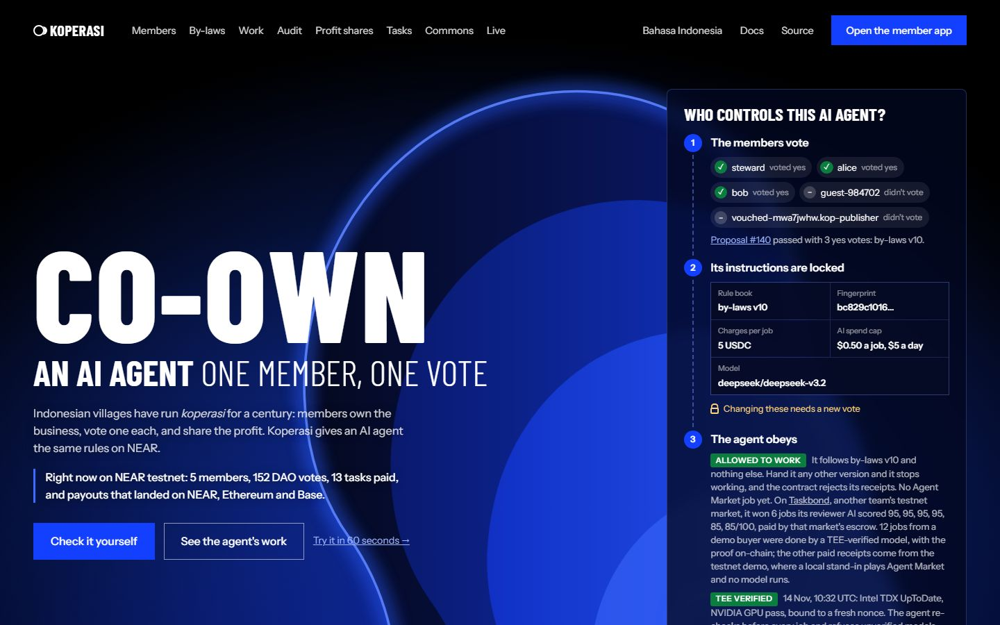
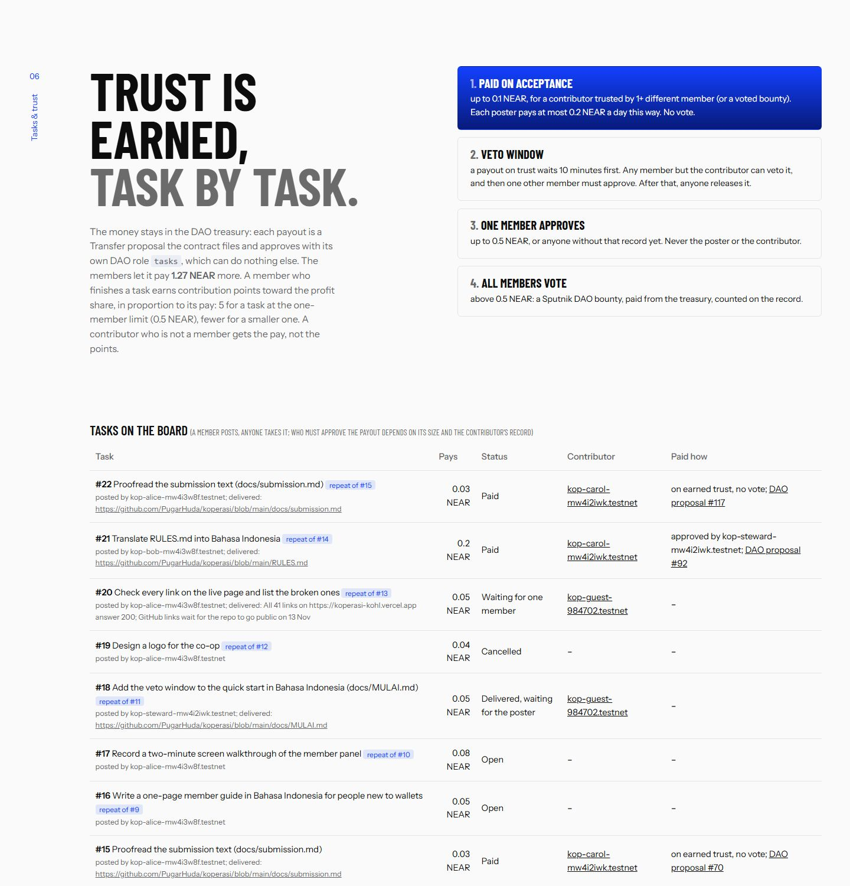
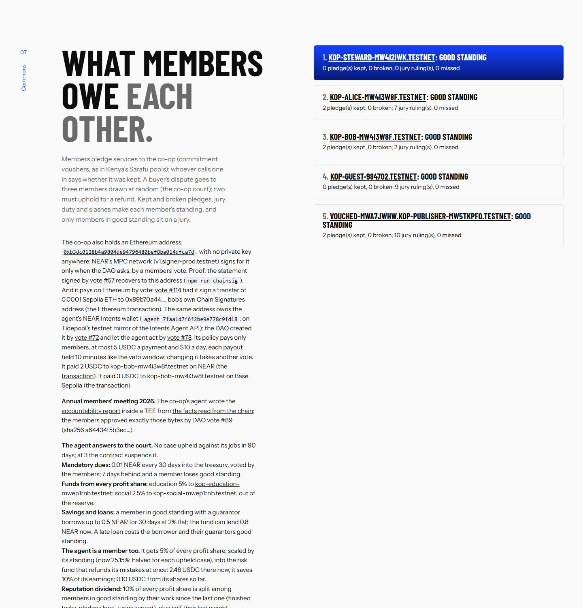
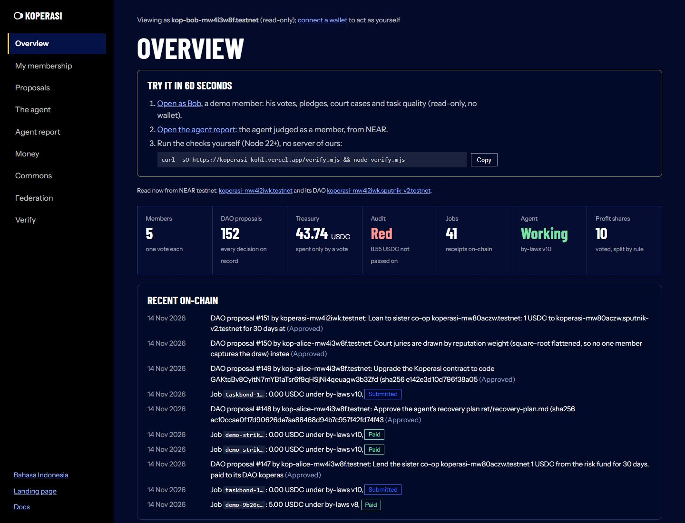
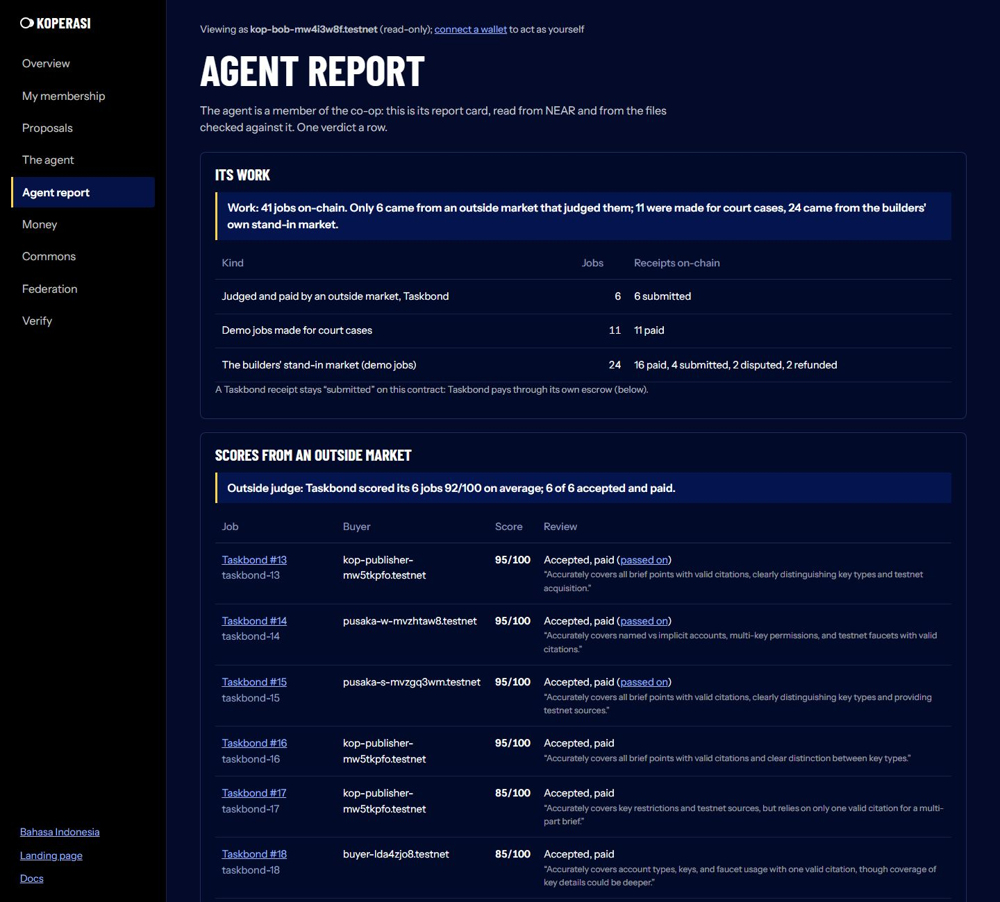
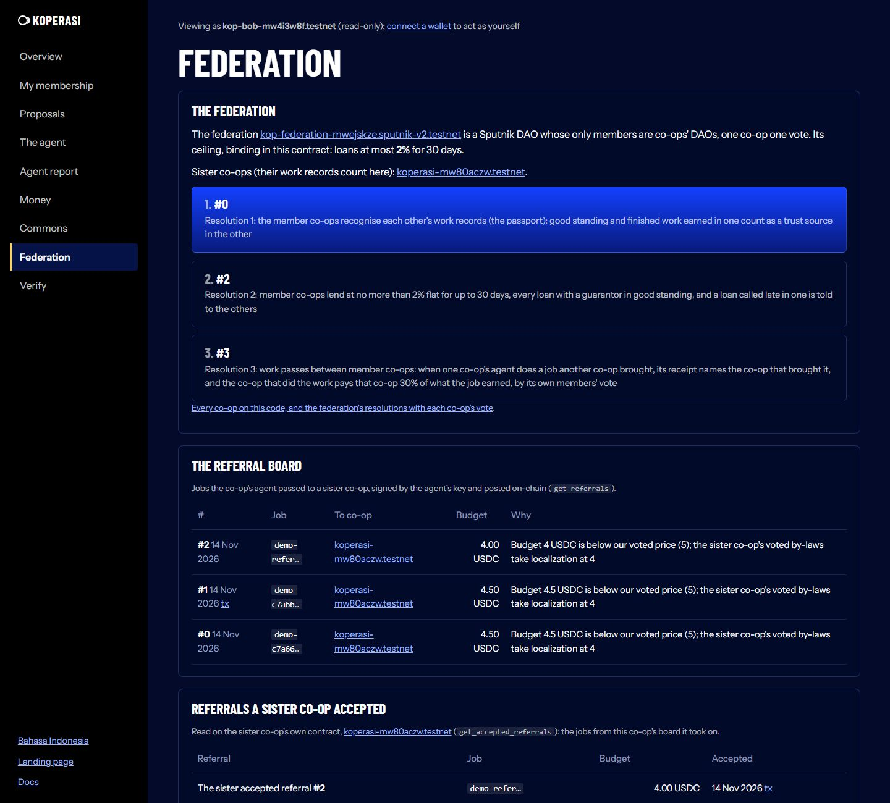
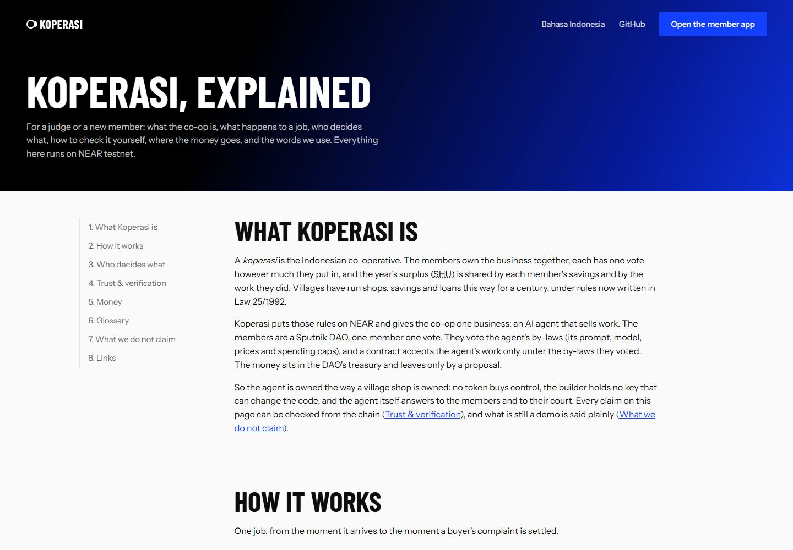
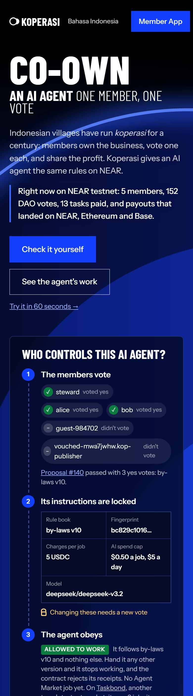
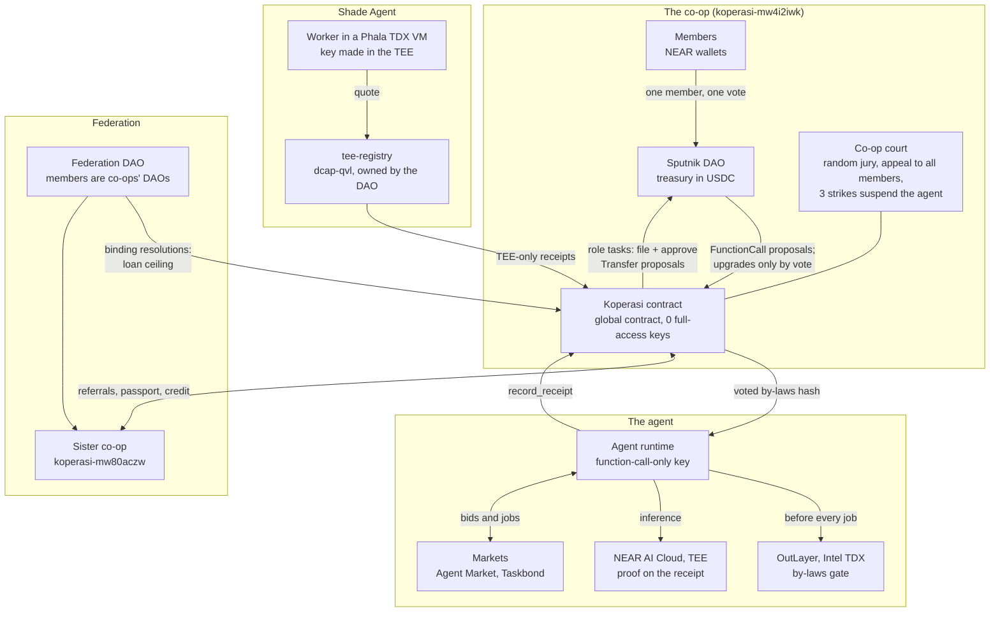

# Koperasi

**A shared treasury for a community that owns an AI agent, built on an unmodified Sputnik DAO.
One member, one vote. Small payouts on earned trust, large ones by vote. Profit shared by a rule everyone voted.**

Beyond tiers by reputation: trust earned in one co-op counts in a sister co-op the members recognise (the passport);
a buyer's dispute goes to a jury of members drawn at random, then on appeal to all of them; before every job the agent
proves on-chain, inside an Intel TDX enclave, that it runs the by-laws the members voted and that the job is one they
allow; each member is paid on the chain they chose; and 19 attacks sent to the live co-op were refused on-chain.
Check every claim in one command, no clone: `curl -sO https://koperasi-kohl.vercel.app/verify.mjs && node verify.mjs`.

A group that pools money gets the same vote for a 5 USDC tip as for a 5,000 USDC grant. So every small payment
waits for a quorum, or one person starts paying out of pocket and settling later. And when the money comes from work
done for the group (here, an AI agent's work), only the person running it can see where it went.

Indonesian villages have solved this for a century with the *koperasi* (co-operative): the members own the
business, every member has one vote, and profit is shared by savings and by contribution. Koperasi puts those rules on NEAR:

- **The money never leaves the Sputnik treasury without a proposal.** The contract holds a DAO role, `tasks`, that may
  only file and approve `Transfer` proposals, and only under the rules below (small payouts it files and approves
  with no member's vote). There is no second wallet and no new multisig. Task payouts are in NEAR, profit shares in USDC.
- **Trust is earned, and it decides who has to vote.** A contributor that another member already paid (never the poster
  alone: a member cannot vouch for someone and then pay them with no vote) is paid when the poster accepts, up to a
  small limit a day. That payout first waits a veto window the members voted (10 minutes), and any member can veto it
  into a vote. Mid-size tasks need one other member, and large ones go to every member as a DAO bounty.
  Every point on a record links to the task or proposal it came from.
- **Profit is shared by rule.** The members vote a split (reserve, savings, contribution). The contract divides
  each payout to the last USDC unit, and each member claims their own share. It is the split an Indonesian co-op
  makes of its yearly surplus (Law 25/1992 art. 45): a reserve first, then members by their savings
  and by their work with the co-op, in proportions the members' meeting sets. The agent
  can also pay the shares from its NEAR Intents wallet to the chain each member chose.
- **The business is an AI agent the members steer.** Its prompt, model, prices and spend caps are by-laws hashed
  on-chain, and they change only by vote. The model's TEE is re-verified within the hour before each job, and any visitor can check it with their own nonce.
  The agent can also propose: it reads its own record and puts new by-laws (a new price) to the members, who decide.
- **The person in the middle is bonded and audited.** The steward who collects the agent's earnings must pass them on.
  The audit is public. The members can slash the steward's bond by vote, and anyone can slash it once a paid job's
  earnings are more than 7 days late (`slash_overdue`).

Built at NEAR HACKATHON (Nov 2026). Main track: **Social Money**. Also Autonomous Business and Agent Economy.

Second project by the same builder, independent of this one: [Pusaka](https://github.com/PugarHuda/pusaka) (live at
https://pusaka-two.vercel.app), NEAR NFTs that hold real Bitcoin through Chain Signatures: sell the NFT and the
Bitcoin goes with it (tracks NFTs That Do Something, Unstoppable DeFi, Open Innovation).

Screenshots of the live site, 14 Nov (every number on them is read from NEAR testnet when the page loads):

| The live page: who controls the agent, read from the DAO | Tasks paid from the treasury, by earned trust or by vote |
|---|---|
| [](https://koperasi-kohl.vercel.app) | [](https://koperasi-kohl.vercel.app/#trust) |
| **What members owe each other: pledges, the co-op court, standing** | **The member dashboard: the co-op at a glance and what just happened on-chain** |
| [](https://koperasi-kohl.vercel.app/#commons) | [](https://koperasi-kohl.vercel.app/dashboard.html?as=kop-bob-mw4i3w8f.testnet#/overview) |
| **The agent's report card: its work and the outside market's scores** | **Federation: resolutions, the referral board, what the sister co-op accepted** |
| [](https://koperasi-kohl.vercel.app/dashboard.html?as=kop-bob-mw4i3w8f.testnet#/report) | [](https://koperasi-kohl.vercel.app/dashboard.html?as=kop-bob-mw4i3w8f.testnet#/federation) |
| **The docs page: what Koperasi is, a glossary, English and Bahasa** | **On a phone (390 px)** |
| [](https://koperasi-kohl.vercel.app/docs.html) | [](https://koperasi-kohl.vercel.app) |

A member's work record, read from the chain: [`/cert.html?who=kop-alice-mw4i3w8f.testnet`](https://koperasi-kohl.vercel.app/cert.html?who=kop-alice-mw4i3w8f.testnet) (pledges kept, jury duty, paid work, each traced to its transaction).

## Try it in 60 seconds

No wallet, no keys, no clone (Node 20+ for the last step).

1. Bob's membership, read from the chain: <https://koperasi-kohl.vercel.app/dashboard.html?as=kop-bob-mw4i3w8f.testnet#/membership>
2. The agent's report card, judged as a member: <https://koperasi-kohl.vercel.app/dashboard.html?as=kop-bob-mw4i3w8f.testnet#/report>
3. What Koperasi is, in plain words (English and Bahasa Indonesia, a 44-term glossary): <https://koperasi-kohl.vercel.app/docs.html>
4. Every claim in this README, checked from testnet (95 checks, about a minute):

   ```sh
   curl -sO https://koperasi-kohl.vercel.app/verify.mjs && node verify.mjs
   ```

Every page (landing, dashboard, work record, co-ops, docs) has a Bahasa Indonesia switch. The longer walk-through is [For judges](#for-judges-60-seconds-no-wallet-no-keys) below and [`JUDGE.md`](JUDGE.md).

## Architecture



Account names and the rest of the flow: [How it works](#how-it-works) and [`docs/DETAILS.md`](docs/DETAILS.md).

## What we do not claim

- **No real Agent Market job yet.** The agent has bid on real Agent Market jobs; none was awarded (0). Its 6 paid jobs
  from outside the co-op came from [Taskbond](https://github.com/demir-sama/taskbond), another team's testnet market,
  and their posters are the builder's accounts too. To test outside demand a fresh wallet, `buyer-lda4zjo8.testnet`, funded only by the NEAR
  testnet faucet and never a member, posted Taskbond job #18, which the agent won (85/100); it is still the builder's wallet,
  not a stranger's. It then bought a job directly with 20 USDC from Circle's own testnet faucet: the agent bid, passed the by-laws
  gate in the TDX enclave, did the work on the TEE-verified model (receipt `demo-da08bb0a…`, its proof names the buyer), and the wallet paid
  5 USDC with the receipt as memo ([GqvwnZj7…](https://testnet.nearblocks.io/txns/GqvwnZj7onLGKsz5scVdBCuC8JD8Vsim7P6GiDtrcU9i)); the receipt stays
  Submitted because the stand-in market never relays the buyer's acceptance.
- **Push notifications go through ntfy.sh, a public service.** A member's topic is private (an HMAC of a secret only CI
  and the API hold, handed out by `/api/notify-topic` after the member's NEP-413 signature), and it was tested end to end
  on 14 Nov: bob signed for his topic, DAO proposal #153 was opened, and the notify workflow pushed it to his topic. A
  push is still only a hint: act on what the dashboard shows. Nobody but the builder has subscribed yet.
- **Loans between co-ops are tiny.** Both were 1 USDC for 30 days; the 5% interest on loan #2 (0.05 USDC) came from the
  steward's USDC (the agent's Agent Market earnings), because the sister co-op had no income of its own to pay it from.
- **Everything is on NEAR testnet.** The money is testnet USDC and testnet NEAR; Sepolia and Base Sepolia for the
  payouts on other chains.
- **The members are the builder's accounts.** 5 members in this co-op and 2 in the sister co-op, all made by the
  builder. They show the mechanism works; they are not independent people.
- **The Shade Agent worker ran once.** It registered, passed the gate and recorded one receipt from inside the TEE;
  its VM was then stopped to save cost. The founding agent's runtime is not in a TEE.
- **The audit is red on purpose.** The 7.60 USDC shortfall dates from before the steward's appointment, so it is not
  slashable; it stays visible rather than being papered over.

## Every claim, its evidence, and the check that reads it

Testnet. `npm run verify` (read-only, no keys) reads each row from the chain and prints PASS or FAIL; the last column
quotes its line.

| Claim | On-chain evidence | `npm run verify` line |
|---|---|---|
| The members own the co-op, one vote each | DAO [`koperasi-mw4i2iwk.sputnik-v2.testnet`](https://testnet.nearblocks.io/address/koperasi-mw4i2iwk.sputnik-v2.testnet): role `member`, RoleWeight, threshold 1/2 | *every member in the contract holds role `member`*; *one member, one vote* |
| No role can act alone | `member` votes, `tasks` only files and approves transfers, outsiders only file proposals (with a bond) | *no role can act alone* |
| The agent runs only by-laws the members voted | v3 by proposal #7 (a member found v2's model was not served), v4 by #55 (the steward's handover), v5 by #96 (a third-party testnet market, and profit shares on a schedule), v6 by #97 (deepseek-v3.2: TDX and 8 GPUs attested, 13 s where the reasoning model timed out), v7 by #124 (a price the agent itself proposed, below), v8 by #136 (written by the agent with the voted model in a TEE), v9 by #139 (the agent's, on a wrong average, below), v10 by #140 (the members restoring v8); the agent runs only `bc829c10…` | *the agent's by-laws … are the ones the members voted* |
| Nobody can change the code alone, the builder included | [`koperasi-mw4i2iwk.testnet`](https://testnet.nearblocks.io/address/koperasi-mw4i2iwk.testnet): 0 full-access keys (the sister co-op too, since 14 Nov: tx `Doqa4tni…`); upgrades only by vote, now #149 (0.3.7, global code `GAKtcBv8…`, a reproducible build, sha256 `e142e3d1…`; the sister co-op by its own #31) | *the contract runs the global contract the members voted*; *nobody holds a full-access key* |
| The agent can only record receipts | `agent.koperasi-mw4i2iwk.testnet`: one function-call key, `record_receipt` / `update_receipt` | *the agent account has only function-call keys …* |
| Small payouts on earned trust, from the treasury itself | Task #2 needed another member (#30); #3 and #4 paid on trust, no vote (#31, #34); #5, #6 (#44, #45). Each a DAO `Transfer` the contract filed | *task #n was paid from the treasury by DAO proposal #m, filed by the contract*; *the trust tiers were voted* |
| Any member can stop a no-vote payout before it leaves | A 10-minute veto window by vote #62. Task #7 waited it out and anyone released it (#64). Task #8 was vetoed by bob ([3oQ43dwi…](https://testnet.nearblocks.io/txns/3oQ43dwiSW48PjG983VRL92Hgw4PJF13hGC1Ntc6qWWT)), so it needed one other member, and the steward approved it (#63) | *a payout on trust waits out the veto window the members voted* |
| Every point on a record names its source | carol 9 tasks, bob 2, the steward 1, each linked to a task or a DAO bounty | *…'s record: n finished, each traced to its source* |
| Profit is shared only by a members' vote, split by the contract | #36: 10 Circle testnet USDC to 4 members; bob claimed his 4.33 in [Cq25VUHM…](https://testnet.nearblocks.io/txns/Cq25VUHME68yfVZDM7ZxdKnjHttHtBhSUF6GXHhsCzxd); #51 filed from a [Trezu](trezu/README.md) form | *the members voted every profit share out of the treasury* |
| The person in the middle is bonded, and serves a term | Appointed by vote #54 under contract 0.2.3, 1 NEAR bond [k6MzrgXV…](https://testnet.nearblocks.io/txns/k6MzrgXVf9E8styeNa5zNoYryY9aLCPvAqoPV1waFKZ); anyone can slash it once a paid job's earnings are 7 days late. A 90-day term by vote #59 (after Hats Protocol): when it runs out anyone ends it | *the steward was appointed by a vote and is bonded*; *the steward serves a term the members voted* |
| A buyer's dispute goes to a jury of members, not to the builder | Case #0 ([opened](https://testnet.nearblocks.io/txns/49D9tavwVg2X8YseBDsgXXzjeJgLUVcNjNG5n9q69E2J) by bob for a job the buyer disputed and the market paid): three members in good standing drawn at random; two upheld ([6z5pkYgS…](https://testnet.nearblocks.io/txns/6z5pkYgSWivVrxTjr8mARUe6DSjAof7M4QtRf8MdrEeF), [3k2UPtib…](https://testnet.nearblocks.io/txns/3k2UPtibuzncctR96YGzy8cMc5Lgysfc9wLnyZ5rSw2Z)); the contract filed and approved refund #60, and the buyer got 0.5 USDC from the treasury | *court case #0: the jury upheld it and the contract refunded the buyer* |
| A jury's "no" can be appealed to every member | The claimant of a dismissed case appeals with a 1 NEAR bond; the contract files the refund as a DAO proposal and does not vote on it (a co-op of five has no larger jury to draw). Case #2: the members overturned the jury, refund #77 paid; case #1: they kept the ruling, #78 rejected. Case #3 then went through a jury as before (#79) | *court case #2: … the members overturned it*; *court case #1: … the members kept the jury's ruling* |
| In court both sides are heard | Contract 0.2.8: while a case is open the claimant and the steward (who answers for the agent's work) each file up to three pieces of evidence. Case #4: bob ([AjJZNktT…](https://testnet.nearblocks.io/txns/AjJZNktTNXSLwVraQj74RjMWWdYF3WZBKKWjz5H3Fgvy)) and the steward ([DffbEsQ5…](https://testnet.nearblocks.io/txns/DffbEsQ5rBufqypV3ooFJ1n1Pe2dfNinHR4N3WJbubzi)) filed theirs; two jurors upheld, refund #84 | *in court both sides are heard …* |
| Members owe each other work, not only money | Pledge #0: alice promised two reviews; bob called both in and said each was kept ([BwFvywKm…](https://testnet.nearblocks.io/txns/BwFvywKmxqX6tyNPWL5jBF1DZp4uctifQ3yMGTmZ9nJh)). Kept and broken pledges, jury duty and slashes are each member's standing; only good standing sits on a jury | *pledges: n, called in m times, kept k, broken 0* (live counts) |
| The co-op holds an Ethereum address with no private key | `0xb3dc0128b4a9804de94796480bef8ba014dfca7d`, derived by NEAR's MPC network (Chain Signatures) from the DAO; vote #57 had it sign a statement naming itself, which recovers to that address | *the DAO holds an Ethereum address with no private key …* |
| The co-op pays on Ethereum by vote, from a form | Proposal #81, compiled by Trezu's own engine from the template [`kop-pay-ethereum`](trezu/testnet/kop-pay-ethereum.json): its description carries the transaction, so the page rebuilds the hash the members sign and warns if it differs; the deciding vote's signature was sent to Sepolia ([0x8cbfea39…](https://sepolia.etherscan.io/tx/0x8cbfea39832739c8ef053c8c567ddce05c97dd5e9f0a6a8945a52fd288fbb740)). Members can file it from the page too | *a payment from the DAO's Ethereum address was signed only after the members voted for exactly that transaction* |
| Each member says where payouts land, on any of four chains | bob routes his to Base, alice to Arbitrum (`set_payout_route`, each to their own Chain Signatures address); vote #80 made the agent's NEAR Intents wallet list exactly those routes (Tidepool's `policy_update`, signed by the DAO's MPC address only after the vote). On 13 Nov the agent shared 5 USDC from that wallet by the contract's voted rule (20% reserve, 40% savings, 40% points): the steward, guest and a vouched member were paid on NEAR, alice on Arbitrum Sepolia ([0x934a3052…](https://sepolia.arbiscan.io/tx/0x934a30527fca9c8eafd068890e6ff22109124142a73c2df6c550b5da6d49deb2)), bob on Base Sepolia, each read back on that chain by `verify` | *the agent's Intents wallet pays each member on the route they set on the contract* |
| A member's record leaves the co-op with them | alice, bob and the steward minted their work records as NEP-171 tokens ([alice's](https://koperasi-kohl.vercel.app/cert.html?who=kop-alice-mw4i3w8f.testnet)): the metadata and the image are read live from the record and the standing, and `nft_transfer` is refused | *…'s work record is a NEP-171 token that reads the record live* |
| Trust earned in one co-op counts in another | Contract 0.2.8, the passport: vote #83 recognised `koperasi-mw80aczw.testnet` (a second co-op from this repo, upgraded to the same code by its own members). carol did 2 paid tasks there and minted her record ([AKd9P8GX…](https://testnet.nearblocks.io/txns/AKd9P8GXeMRtUoWb5uGWBnKV16tbtjkVmpnwuvp6nfeq)); the contract read that token itself and stamped her passport ([A6fSvb3K…](https://testnet.nearblocks.io/txns/A6fSvb3KzZxeJLjXRkkxiNwYNnafjw9rP9DDnoeU2Kiz)): her trust sources here went 0 → 1. A record that loses good standing loses its stamp; a co-op the members drop stops counting ([her record](https://koperasi-kohl.vercel.app/cert.html?who=kop-carol-mw80aczw.testnet)) | *a work record from a sister co-op the members voted counts here …* |
| The agent checks its by-laws, and the job, in an enclave before every job | The runtime calls OutLayer (Intel TDX) before it starts a job: the enclave reads the voted hash from NEAR, hashes the by-laws file and, since 13 Nov, judges the job itself by the by-laws' `job_filter` (tags, minimum price); a job it refuses is handed back. The receipt's proof names the transaction. Two jobs done by a TEE-verified model this way: `demo-97ffe708…` (gate [13FLoSGv…](https://testnet.nearblocks.io/txns/13FLoSGvYwnU92epwyJ5vsBUVfEnFxUuz8q6fDQi9cun)) and `demo-38c711c5…` (gate [951PGMai…](https://testnet.nearblocks.io/txns/951PGMaijY4uNmeHWfU8ZL8mbMsHz1WP7LY212NZiEqr), job judged allowed) | *every job that names a by-laws gate had its by-laws checked inside an Intel TDX enclave first* |
| The members approve the year's accounts, written by their own agent | The annual members' meeting every Indonesian co-op holds (Law 25/1992 art. 22–26), on-chain. Members put items on the agenda (contract 0.2.9: alice asked for monthly dues, bob why 7.60 USDC is still owed); `scripts/rat.mjs` reads the year's facts from the chain ([`rat/2026.facts.json`](https://koperasi-kohl.vercel.app/rat/2026.facts.json)), the co-op's agent writes the accountability report from them only, with the voted by-laws' model on a TEE-verified server ([`rat/2026.md`](https://koperasi-kohl.vercel.app/rat/2026.md), $0.004), answering each agenda item, and vote #89 approved it by calling `record_annual_meeting` with both sha256, and in the same proposal set the dues the agenda asked for. The agenda reaches the model fenced as untrusted text, and the report names any figure not found in the facts. Earlier drafts #85 and #86 were polls, replaced (#85's facts counted the stand-in market's receipts as Agent Market jobs) |
| Members pay mandatory dues, or lose good standing | 0.01 NEAR every 30 days into the treasury, set by the annual meeting's vote #89; all five members paid two periods ([2PpRStat…](https://testnet.nearblocks.io/txns/2PpRStatHVmcfVPxC8JGoQCQKyH4X2qNHf4awLhytmPf)); more than 7 days behind, a member sits on no jury and opens no case | *mandatory dues were set by a members' vote …* |
| The agent answers to the court | Each case upheld against one of its jobs is a strike: the agent's daily inference budget halves per strike in 90 days, and at 3 the contract refuses its receipts until the members reinstate it. Case #5, upheld ([ASSsqDJZ…](https://testnet.nearblocks.io/txns/ASSsqDJZzhDzTZwyfHdWzCccWg84bm2jkVa3h2CA3eUT)), is its first strike | *the agent answers to the court …* |
| Co-ops federate, one co-op one vote | A secondary co-op (Law 25/1992 art. 15–16): Sputnik DAO `kop-federation-mwejskze.sputnik-v2.testnet`, whose only members are the two co-ops' DAOs. Its resolution #0 (mutual recognition of work records) passed because each co-op's own members voted to cast its vote: #87 in the showcase, #9 in the sister co-op. The sister recognises the showcase too (#8) and counts carol's 9 tasks from here | *a secondary co-op …*; *the recognition is mutual …* | *the members approved the 2026 annual report by vote …* |
| The agent wins work judged by someone else | Agent Market has no testnet; [Taskbond](https://github.com/demir-sama/taskbond), another team's testnet market, does. By-laws v5 let the agent take research jobs there. Job #13 was posted by a non-member ([CtKtZtYN…](https://testnet.nearblocks.io/txns/CtKtZtYNkVLVY2mMvYP3gro6Wqak47FMQzjCLNzMiBtD)); Taskbond's guardrail AI approved the agent's voted system prompt; the agent did the work on a TEE-verified model, quoting the pinned sources exactly ([Aq9vfpJQ…](https://testnet.nearblocks.io/txns/Aq9vfpJQRsHCHAQFnBFr1cMHFkxP4B3VG6zud6pBnEUx)); **Taskbond's reviewer AI scored it 95/100** and its escrow paid the steward 0.1 testnet NEAR, passed on to the treasury ([CqBieK14…](https://testnet.nearblocks.io/txns/CqBieK14pn1rkb2c4SBFoQZpi9M9kQPCLDD8xcYPoHPw)). Receipt `taskbond-13` carries the TEE proof. Job #14 was posted from another wallet, `pusaka-w-mvzhtaw8.testnet` (an account of the builder's other project, outside the co-op): **95/100 again** ([6GtJVoSb…](https://testnet.nearblocks.io/txns/6GtJVoSbn5yJsbGAvV3nYfkFu5JdH5pCp8u1tLfma8jx)), reward passed on. Both posters are still the builder's accounts: an independent buyer is the next step | *the agent won a job on a third-party testnet market (Taskbond) …* |
| Profit shares run on a schedule the members voted | By-laws v5: every 30 days, the agent's wallet shares what it holds above 1 USDC (at least 2) by the contract's rule, each part on the member's route. `intents.mjs share auto` does nothing until a share is due and holds a lock, so a payout is never sent twice; the agent's runtime starts it on every pass | (the schedule is in the voted by-laws; the shares themselves are checked as above) |
| The court can suspend the agent, and the members bring it back | Cases #5, #8 and #9 upheld against its jobs made three strikes: the contract then refused the agent's receipt ([BCqfR5HS…](https://testnet.nearblocks.io/txns/BCqfR5HS8ghkNn4jPQUqvgBxTkUgRhCHBjh5bjQyqgfS)) until the members reinstated it by vote #100 | *the court suspended the agent after three upheld cases …* |
| An annual meeting can say no | The sister co-op rejected its first 2026 report (#12: nothing recorded), a member put the missing question on the agenda, and the next draft was approved and recorded (#13) | *an annual meeting can say no …* |
| The federation moves money | Each co-op paid 0.5 NEAR into the federation's shared reserve by its own vote (#101, sister #14); a 0.3 NEAR grant from it to the sister co-op passed by both co-ops' votes (federation #1, cast by #102 and #15). [`/coops.html`](https://koperasi-kohl.vercel.app/coops.html) shows the network | *the federation runs a shared reserve …* |
| Funds from the surplus, as the co-op law sets | Contract 0.3.0: vote #104 set an education fund (5%) and a social fund (2.5%) paid from every profit share's reserve; the 2 USDC share #105 paid them 0.10 and 0.05 USDC on its own | *funds from the surplus … are paid from a profit share's reserve* |
| Members stand surety for each other, and lend to each other | Contract 0.3.0 (*tanggung renteng*, savings and loans): alice stands surety for bob and guest; vote #106 set a 1 NEAR loan fund (up to 0.5 NEAR, 30 days, 2% flat); bob borrowed 0.3 NEAR (the contract filed and approved #107) and repaid 0.306 into the treasury ([4pRGFNhL…](https://testnet.nearblocks.io/txns/4pRGFNhLfCXNXsX2PiY2h9V1BcqwDtzM8ccWWAP5dTaX)); guest's 0.2 NEAR loan (#108) is open. If a guaranteed account falls out of good standing, its guarantors do too, until the members clear them | *savings and loans: members with a guarantor borrowed …* |
| More than one agent, each with the work the members gave it | Contract 0.3.1: vote #110 made `kop-translator-mwepareu.testnet` a second agent for translation and localization jobs. Like the founding agent it holds one function-call key (record and update receipts on the co-op's contract only) and no full-access key. Its runtime took only a localization job, checked the by-laws in the enclave, and its receipt names it | *a second agent the members voted takes only its jobs …* |
| A further agent runs by-laws of its own | Contract 0.3.2: vote #121 gave the translator its own by-laws v1 ([`config/translator/config.v1.yaml`](config/translator/config.v1.yaml), `set_agent_config`): its receipts must carry that hash, and the enclave gate reads that file for it | *… the translator its own by-laws* |
| The agent saves for its own mistakes | Contract 0.3.2: a risk fund the contract holds refunds a case upheld against the agent at once, with no proposal. Vote #121 set the agent to save 10% of every earnings deposit into it (its whole cycle is below) | *the members voted the agent to save into the risk fund …* |
| Credit comes from the record | Contract 0.3.2: a loan is at most the largest loan the members voted times the borrower's score out of 10: finished tasks, pledges kept, juries served, two points per guarantor in good standing. alice scores 7 (up to 0.35 of 0.5 NEAR) | (`get_credit`; the card below) |
| Part of the surplus follows the work done | Contract 0.3.2, a reputation dividend: vote #121 split 10% of every profit share (out of the reserve) among members in good standing by their record (work done, pledges kept, juries served; guarantors left out, since two members can vouch for each other at no cost). The 2 USDC share #122 paid it by scores 10, 7, 7, 6 and 1. Since 0.3.3 a weight is the work added since the last dividend plus half the last weight: never capped, recent work counts most | *a profit share paid the reputation dividend by each member's record* |
| A member's card shows their credit | The work-record token now also reads the credit score, the loan it allows, dues and any open loan, live: alice's says "credit 7/10 (loan up to 0.35 NEAR); dues paid" ([her card](https://koperasi-kohl.vercel.app/cert.html?who=kop-alice-mw4i3w8f.testnet)) | *the member card … shows the credit score, dues and loan* |
| The agent proposes, the members decide | Contract 0.3.2, `agent_propose_bylaws`: the agent read its record (23 jobs settled, 4 refunded or disputed, 17%; inference $0.0003 a job) and proposed by-laws v7 at 5 USDC instead of 4 ([`config/config.v7.yaml`](config/config.v7.yaml), `scripts/v032.mjs propose`). Its key opens only its receipts, so it signed the proposal and a relayer submitted it; the contract checked the signature against the key of the agent's last receipt, filed DAO proposal #123 with the agent's reason and its own bond, and did not vote. The members approved it, but the call failed: it named the agent as contributor, and `set_config` gave points only to members. So the members passed the same file by #124, and the code was fixed (a non-member contributor is named with no points). An Intel TDX enclave checked v7 through OutLayer | *the agent proposed new by-laws from its own record …* |
| The federation sets shared rules | Resolution #2 (member co-ops lend at no more than 2% flat for up to 30 days, each loan with a guarantor, and a loan called late is told to the others) passed by each co-op's own vote: #111 here, #18 in the sister co-op | *the federation's resolution #2 passed by each co-op's own vote* |
| A profit share in ETH, by vote | Sepolia ETH to every member with an EVM route, split by the voted rule; each payment signed by Chain Signatures only after its own vote: alice ([#115](https://sepolia.etherscan.io/tx/0x328172c58946734c59de7b454ae5e8f166cfe0359d0248c1d267b6110411192c)), bob ([#116](https://sepolia.etherscan.io/tx/0x9ee24f8013ea885f92a7d6bcf1fe550d16cd0a2aeba2afafa9b928544e56f748)); two signatures in one proposal time out on testnet's MPC (#112, #113) | *a profit share in Sepolia ETH went to each member's EVM route …* |
| What needs a member reaches them outside the page | `/api/inbox?who=<account>`: proposals to vote (the agent's own by-laws called out), juries, pledges to confirm, dues due, USDC to claim, a loan due or late here or at a sister co-op, as an RSS feed read from the chain on each request, with no account and no secret; any feed-to-email or feed-to-Telegram service delivers it. Linked from the wallet panel | (unit tests of `api/inbox.mjs`) |
| The agent is a member too | Contract 0.3.3: vote #127 gave the agent 5% of every profit share, out of the reserve, into the risk fund its mistakes are refunded from (its key can only record receipts, so it holds no money). The share is halved for each case upheld against it in 90 days and is nothing while it is suspended: share #132 paid it 0.05 USDC (what the reserve had left after the funds and the dividend); after case #10 its standing is 50% | *the agent is a member too …* |
| The risk fund, a whole cycle | The demo buyer paid the job the agent did on 13 Nov (the stand-in market never pays); the steward deposited it as earnings and the agent saved 10% (0.38 USDC) into the fund. Case #10, upheld by two jurors, refunded the buyer 0.40 USDC from the fund at once: no DAO proposal, no wait | *the risk fund's whole cycle …* |
| The federation's rules bind the code | Contract 0.3.3: each co-op named the federation by its own vote (#127, sister #23). Federation resolutions #4 and #5, each passed by both co-ops' votes (#128/#24, #129/#25), call each contract's `set_federation_rules`: loans at most 2% flat for 30 days. Only the federation's DAO can set it. The members of the showcase then voted 4% loans (#130): Sputnik approved it, the contract refused it, and the rule is still 2%. A loan called late is told to every sister co-op, where the borrower's credit is 0 until it is repaid (tested; no loan has been late on testnet yet) | *the federation's loan ceiling binds each co-op's code …* |
| Credit travels with the passport | Contract 0.3.3: work stamped from a sister co-op in the last 30 days counts toward credit. carol has no record here, yet scores 2 of 10 from the 2 tasks stamped from `koperasi-mw80aczw` | (`get_credit`) |
| The agent judges its own proposals | `scripts/v033.mjs propose`: the agent reads its record from the chain, including how the jobs went since its last proposal, and writes its next by-laws with the voted model on a TEE-verified server (the facts are published, [`agent-proposals/v8.facts.json`](https://koperasi-kohl.vercel.app/agent-proposals/v8.facts.json), their sha256 in the record). It may change only the price, the minimum price, the inference caps and the job tags, within set ranges. On 13 Nov it proposed nothing: "Too few jobs to evaluate the last proposal". After 3 more jobs, paid in full, it wrote by-laws v8: "Too few jobs (4) under the last proposal to say if it was correct, but all were paid and profitable"; a minimum price of 3 USDC and a daily inference cap of $5; the members approved it (#136) and an Intel TDX enclave checked v8 through OutLayer. Then a mistake, kept in the record: under v8 it proposed v9 (a price of 3) from an average price that counted a Taskbond job, paid in testnet NEAR, as a 0 USDC sale; the demo members' script voted for it (#139) without reading it. A member then proposed v10, v8 restored, and the members passed it (#140); the agent's facts now average USDC sales only, and the script no longer votes for the members. Asked again, the agent proposed nothing: no jobs under v9 yet | *the agent judged its last proposal and wrote its next by-laws itself …* |
| Work passes between co-ops | Federation resolution #3 (#125 here, #20 in the sister): a co-op whose agent does a job another co-op brought pays that co-op 30% of what it earned. The sister's agent did a localization job the showcase brought (its by-laws checked in the enclave, a TEE-verified model; its receipt names the showcase, and the runtime records only a co-op its members recognise); the buyer paid, the sister's steward deposited it, and the sister's members voted 1.14 USDC to the showcase's treasury (#21) | *work passes between the federation's co-ops …* |
| Reputation weighs judgment, not only volume | Contract 0.3.4: a member's reputation weight is multiplied by (good + 2) / (bad + 2) from the court's last 200 cases: a juror who ruled with the outcome and a claimant whose case was upheld count for them, the opposite against. Share #135 paid it: the steward, with no work since the last dividend, got none (its weight decayed away); the vouched member, 8 rulings with the outcome and none against, weighs 5 times its work | *(weights: `get_reputation_weights`)* |
| The agent passes on work it cannot take | `agent/route.mjs`, in the runtime: a job below its members' price goes to the cheapest sister co-op whose voted by-laws (sha256 checked against its contract) take it within the budget. A 4.5 USDC localization job went from the showcase (5 USDC) to the sister (4 USDC) by the agent's own decision ([`scripts/route-demo.mjs`](scripts/route-demo.mjs)); the sister's agent did it and its members paid the 30% (#27) | *work passes between the federation's co-ops …* |
| The agent thinks about its by-laws by itself | `agent/propose.mjs`, in the runtime: when the members' interval has passed and 3 jobs settled under the current by-laws, it reads its record and writes a proposal with the voted model in a TEE, or proposes nothing | (the runtime's log; `web/agent-proposals/`) |
| Polls that become by-laws, juries by reputation, loans at interest (0.3.7) | Contract 0.3.7, voted in by #149 (the sister co-op by its own #31). **Juries by reputation:** the members voted (#150) that the court draws jurors by reputation weight, flattened by a square root so no one member captures the draw. **The agent asks for a loan:** the agent signed a request to lend the sister co-op 1 USDC for 30 days at 5% (500 bps), a relayer submitted it, the contract checked the signature and filed DAO #151, and the members approved it (loan #2). **Interest into the surplus:** the sister's members repaid 1.05 USDC by their own vote (its #32): the principal back into the risk fund, the 0.05 USDC interest to the co-op's treasury (43.69 → 43.74 USDC), loan #2 Repaid. **A poll's by-laws become a proposal:** a technical poll may carry by-laws on an option; when it closes, the contract files the winner as a `set_config` DAO proposal for the members to vote. Poll #1 (keep v10, or v11: the prompt asks for a link to each cited source) is weighed by reputation, 480 to 260 so far; it closes at 12:30 UTC on 14 Nov | *court juries are drawn by reputation weight …*; *the agent asked the members to lend a sister co-op …*; *a sister co-op repaid a loan with interest …* |
| Co-ops that refer, lend and recover (0.3.6) | Contract 0.3.6, voted in by #144 (the sister co-op by its own #29). **Referrals both ways:** the sister co-op's contract reads this co-op's referral board itself (a cross-contract call) and accepts the job, signed by its agent: referral #2 accepted, and a job that already has a receipt there is refused. **Loans between co-ops:** the members lend a sister co-op up to half the risk fund, paid to its DAO treasury (DAO #147: 1 USDC for 30 days; #146's first try bounced because the sister's DAO had no USDC storage, and the risk fund got it back). The sister repaid it by its own vote (its #30): loan #1 Repaid. **Reputation for technical questions only:** the members voted that technical polls weigh each member's reputation (#145); general ones stay one member one vote (poll #0: 280 vs 220). **Recovery after a strike, for real:** two more upheld cases (#11, #12, priced at a millionth of a USDC each) suspended the agent for a minute; the steward filed [a recovery plan](web/rat/recovery-plan.md), the members approved it by its sha256 (DAO #148), and the agent works again with its profit share climbing back from 25% over 30 days | *a referral closes the loop …*; *technical questions are weighed by reputation …*; *co-ops lend to each other …* |
| Task quality and a referral board (0.3.5) | Contract 0.3.5, voted in by #143: the reputation factor also counts work: a paid task for the member (at most 10), a task handed back or a vetoed payout that was then cancelled against them. **Live:** bob handed back task #17 he never delivered and his weight fell 275 → 220. The agent's referrals to sister co-ops go on an on-chain board (`get_referrals`), signed by the agent (ed25519, its own nonce) and refused for a co-op that is not a sister, a suspended agent or an unattested TEE-only one. **Live:** referral #1, the job it passed to the sister co-op, submitted by a relayer | *the agent's referral of a job to a sister co-op is on the co-op's board …*; *task quality counts in the reputation weight …* |
| Agents that must run in a TEE (Shade Agent) | Contract 0.3.4: the members named a TEE registry, [`kop-tee-mwfb5bj2.testnet`](https://testnet.nearblocks.io/address/kop-tee-mwfb5bj2.testnet) (#134), whose contract ([`tee-registry/`](tee-registry/src/lib.rs)) verifies an Intel TDX quote on-chain with `shade-attestation` (dcap-qvl): up-to-date TCB, report data = the worker's implicit account (its key made in the TEE), and a PPID and code (the compose hash of [`agent/phala-compose.yml`](agent/phala-compose.yml), which pins this repo at a commit) the co-op's DAO approved. An agent the members mark TEE-only records receipts only while that holds, and a revoked one stays out until they vote it back. **Live:** a worker in a Phala TDX VM (`c4ebe4db…`, implicit, its key made in the TEE) was first refused (its machine not yet approved), the members approved its code and machine (#137) and admitted it TEE-only (#138), it registered (quote verified on-chain, valid 7 days), passed the by-laws gate in the OutLayer enclave and recorded receipt `demo-33693cb6…` from inside the TEE | *a Shade Agent: a worker whose key was made in an Intel TDX VM …* |
| The members review the agent, as they review the board | `scripts/agent-review.mjs`: at the members' meeting the agent writes its own review from facts read from the chain (its jobs, the court, its savings, each proposal and its mistakes), with the voted model in a TEE ([`rat/agent-2026.md`](https://koperasi-kohl.vercel.app/rat/agent-2026.md)). The first draft read the stand-in market as an outside market and took the TEE worker for itself: the members rejected it (#141, [kept](https://koperasi-kohl.vercel.app/rat/agent-2026.rejected.md)); the second, from clearer facts, they accepted (#142), its one slip noted | *the members reviewed the agent …* |
| Attacks are refused by the chain, not by a promise | `scripts/redteam.mjs` sent 19 attacks to the live co-op as real transactions: an outsider rewriting the by-laws, a member voting themselves points or swapping the code, the agent recording work under unvoted by-laws or the same job twice, selling a work record, stamping a passport by hand, voting in the DAO without the role … Each failed on-chain with the contract's or the DAO's own refusal; the transactions are in `deployment.testnet.json` → `redteam`, and the page re-reads them | *every attack sent to the live co-op was refused on-chain (19 transactions)* |
| Anyone can join and leave; a member can vouch with a signature | `kop-guest-984702.testnet` asked from the page and was voted in (#8); `vouched-mwa7jwhw…` asked with alice's **NEP-413 signed vouch**, which every member's browser checks against alice's full-access key before voting ([screenshot](docs/img/signed-vouch.png)), and was voted in (#56, [joined](https://testnet.nearblocks.io/txns/CEPs9FH7U7Ng9wQowsWYoGQgYRvDELFc4BpRnPDdYpCf)); `kop-leaver-mw8pw94w.testnet` left with its deposit in [pH35xFRx…](https://testnet.nearblocks.io/txns/pH35xFRxjKWxqwGhJ4VXzL3mvphTQDxAvNF7R1wruzV) | (page flows; E2E tests) |
| Members pay no gas | NEP-366 relayer, calls without a deposit: [7pziyP7a…](https://testnet.nearblocks.io/txns/7pziyP7aXe8aKMKKRSWo18dfCpAhTaHtHc2vTJsNmdBN) | (unit tests of `api/relay.mjs`) |
| The model runs in a TEE, checkable by you | The voted model, deepseek-v3.2, is served through Chutes on NEAR AI Cloud: Intel TDX and 8 NVIDIA GPUs, re-verified by the agent within the hour before each job (saved daily in [`evidence/`](evidence)). The page checks it with your browser's nonce: the TDX quote against Intel's collateral, its report data bound to your nonce and to the instance's certificate, and the measurements (MRTD, RTMR0–3) equal to Chutes' pinned ones ([`web/chutes-measurements.json`](web/chutes-measurements.json), kept equal to the agent's by a unit test). Fixed 13 Nov: from by-laws v6 the page said *Not verified*, because it could not read a Chutes attestation | `node agent/tee.mjs deepseek/deepseek-v3.2` → `VERIFIED` |

Live page: **https://koperasi-kohl.vercel.app** (static, reads the contract and the DAO straight from NEAR). The member dashboard: **https://koperasi-kohl.vercel.app/dashboard.html** (overview, membership, proposals, the agent, the agent's report card, money, commons, federation, verify; `?as=<account>` shows any member's view read-only). The docs page, with how it works and a glossary: **https://koperasi-kohl.vercel.app/docs.html**.

The members (alice, bob, the steward, guest-984702 and one who joined with a signed vouch) and carol, a contributor who
is not a member, are the builder's demo accounts. They show that the mechanism works,
but they are not independent people. The agent has done **no Agent Market job yet** (its paid outside jobs are the 6 from Taskbond above): the first 4 receipts come from `npm run
demo` against a local stand-in for Agent Market, which has no testnet. The co-op's NEAR AI credits are in place and the
agent has bid on 9 real Agent Market jobs; none was awarded yet. One receipt shows the real path end to end: job
`demo-72a0451c…` came from the same local stand-in buyer, but the agent did it on NEAR AI Cloud after checking the
model's TEE attestation, checked that a TEE signing key signed the answer, and booked the billed cost ($0.002392) with
the proof on-chain (`get_proof`); it stays *Submitted* (the stand-in buyer never accepts), so it adds nothing to the
steward's audit. The old audit shortfall (7.60 USDC) dates from before
the steward's appointment under 0.2.3, so it is not slashable; it stays red on purpose (the demo's last step). The court's
job `demo-court-mwag2r51` is a demo receipt too (`node scripts/commons.mjs --court`); bob sent the steward the 0.95 USDC
it earned after the market's fee, in testnet USDC, and the steward passed it on ([EH9Sz6Dz…](https://testnet.nearblocks.io/txns/EH9Sz6DzGeRbf4T6QZhN9VA3uUk28X3UaQj3CuazqW7U)), so a demo job does
not make the steward's bond slashable. The demo jobs of 12–13 Nov (two gated, TEE-proven jobs and two court
cases) added 9.50 USDC the stand-in market never paid; the steward passed it on ([9fQTePSQ…](https://testnet.nearblocks.io/txns/9fQTePSQYAtdNwYoRUEpERnxcGQ63v4KB863Y1QtFzU1)), so nothing is slashable.

`node scripts/scenarios.mjs` then put the showcase in every state the page shows, with real transactions: tasks #9–#15
open, taken, handed back and delivered by someone else, cancelled, waiting for a member (contributor not trusted yet),
approved above the no-vote limit (paid by proposal #66), and held in the veto window, then released after it (#70); pledges partly called in, never
called in, and kept; court cases #1 and #2 not upheld (one unanimous, one split 1–2), so those claimants' bonds went to
the treasury; five more `demo-` receipts (submitted, disputed, refunded, and the two court jobs, whose 0.19 USDC the
steward passed on: [RdRftXtM…](https://testnet.nearblocks.io/txns/RdRftXtM2DguVVKyRMEUcmo5ACQyEmdxWf6AZxkEd3W)); a 2 USDC profit share (#67) three members claimed;
proposal #68 to drop the veto window, rejected by the members; and #69, still open for votes.

## For judges: 60 seconds, no wallet, no keys

The full read-only checklist, with what you should see at each step, is [`JUDGE.md`](JUDGE.md). Every claim in one
command, no clone (Node 20+): `curl -sO https://koperasi-kohl.vercel.app/verify.mjs && node verify.mjs`.

1. Open **https://koperasi-kohl.vercel.app**. Under the headline, *The Social Money brief, proven live* reads each line
   of the track's brief and the co-op's activity from the chain. Then *Don't trust us* runs four checks in your browser:
   the by-laws hash matches the vote, the contract has 0 full-access keys and runs voted code, and the audit is shown. Click
   *Verify … with your own nonce* to check the model's Intel TDX and GPU attestation against a nonce your browser made.
2. Scroll to **06 Tasks & trust**. It shows the tiers and the veto window the members voted, tasks in every state, who approved each task, and the DAO proposal
   that paid it. A member's record links each point to its source.
   Then **07 Commons**: a buyer's dispute decided by three members drawn at random, refunded by DAO proposal #60; each
   member's standing; the co-op's Ethereum address, which signs only by a vote. Any member's work record is at
   `/cert.html?who=<account>`.
3. `npm install && npm run verify` reads every claim above from testnet, without keys or transactions: by-laws, code,
   keys, members, the `tasks` role, the trust rule, every payout and profit share against the vote behind it.
   It ends with `every claim checks out`.

Want to join? Open the page with a member's invite link (`?invite=<member>`), connect a testnet wallet, pay the 0.5 NEAR
join deposit, and ask. A link that carries the member's signed vouch (the page's *Invite someone*, or
`node scripts/vouch.mjs <member> <you>`) is voted in by the demo members' bot within 30 minutes; any other request
waits for the members to vote by hand (a deposit alone would let anyone out-vote the members with a few accounts).

## What is new here

The closest earlier projects let a DAO own an AI agent; none lets the owners check what the agent runs or audit who
holds its money:

- [**Agents With Benefits**](https://devfolio.co/projects/agents-with-benefits-3569) (ETHDenver 2024, on NEAR): DAOs
  register agents and share their revenue. Koperasi adds by-laws the contract enforces by hash, the model's TEE checked
  against the visitor's own nonce, a bonded and audited steward, and payouts tiered by trust earned on-chain.
- [**DAO Genie**](https://ethglobal.com/showcase/daogenie-nha62) (ETHGlobal Bangkok 2024 finalist): members vote and an
  agent acts. Here the vote pins the agent itself (prompt, model, prices, caps), and every claim is checked on-chain by
  `npm run verify`.
- Savings circles (Celo's [AjoAI](https://www.karmahq.xyz/project/ajoai/about), [Tanda](https://ethglobal.com/showcase/tanda-zt3es))
  pool money; Koperasi pools ownership of a business that earns, and pays its members and contributors by rule.

What none of them has, and Koperasi does, each on testnet with its evidence above:

- **A credit bureau the co-ops own.** Indonesia's banks share loan records through the regulator's bureau (SLIK OJK);
  here the co-ops' own federation is the bureau. A loan called late in one co-op is told to every sister co-op by the
  contracts themselves, where the borrower's credit drops to 0 until it is repaid; credit earned in one co-op travels
  in the passport; and the federation's loan ceiling is written into each co-op's code, not into a policy PDF.
- **The agent's own savings (*simpanan*).** The agent is a member that answers for itself: it saves part of every
  earning, gets a share of the surplus scaled by its record in court, and that fund refunds a buyer the moment a jury
  upholds a case against its work. A member that loses cases earns less, like any member.
- **Agents that hire each other across co-ops, under rules people voted.** An agent passes a job its members' price
  does not fit to the sister co-op whose voted price does, by its own decision; the federation (of people's co-ops)
  sets the share the co-op that brought the job receives.

The sister co-op was deployed earlier on another testnet USDC (`usdc.fakes.testnet`), so its 30% shares are paid in
that token; on mainnet both would use Circle's USDC.

More in [`docs/DETAILS.md`](docs/DETAILS.md#prior-art-and-what-is-different).

## Ostrom's eight principles, on-chain

Elinor Ostrom's Nobel-winning study of commons that last (fisheries, irrigation, pastures) found eight design principles.
Each one here is a contract rule or a vote you can read:

| Principle | In Koperasi | Evidence |
|---|---|---|
| 1. Clear boundaries | membership is the DAO's `member` role, a join deposit, and a vote; a member can vouch with a signed message | #8, #56 |
| 2. Rules fit the place | the members vote the agent's by-laws (model, prompt, prices, caps) and the trust rule | by-laws v4 #55 |
| 3. Those affected make the rules | one member, one vote (RoleWeight, threshold 1/2) on every rule above | `npm run verify` |
| 4. Monitoring | the audit (paid jobs against what the steward passed on), NEP-297 events on the page, TEE checks in your browser, `npm run verify` daily in CI | the page's *Don't trust us* |
| 5. Graduated sanctions | a broken pledge or a missed jury costs good standing (no jury seat); a lost court case costs a 0.5 NEAR bond; a steward 7 days late loses the 1 NEAR bond, to anyone's call | `get_standing`, `slash_overdue` |
| 6. Cheap conflict resolution | the co-op court: three members drawn at random, two must uphold, a refund at most the job's price | case #0, refund #60 |
| 7. Right to organize | no outsider can change the rules: the contract has no full-access key, the builder's included, and its code changes only by vote | upgrades #53, #58 |
| 8. Nested enterprises | the contract is a role inside the DAO (`tasks`: file and approve transfers only); the DAO holds an Ethereum address through NEAR's MPC network, used only by vote; co-ops form a federation whose only members are their DAOs, each voting by its own members' decision | #57; federation resolutions #0–#2 |

## Built on NEAR, end to end

| NEAR piece | What it does here |
|---|---|
| **Sputnik DAO v2** | membership (role `member`), every vote, the treasury; the contract holds role `tasks` (file and approve transfers only); bounties for large tasks |
| **Trezu** | [custom proposal templates](trezu/README.md) for profit shares, trust rules, budgets, points, slashing, pause; #51 was filed from one |
| **Global contracts** | the code is a global contract the members switch to by vote (`upgrade({code_hash})`); the account has no full-access key |
| **NEP-141** | Circle's USDC on NEAR: earnings in (`ft_transfer_call` "earnings"), profit shares (`"share"`), claims |
| **NEP-297 / NEP-330** | an event for every state change (the page's live feed); source metadata of a reproducible `cargo near` build |
| **NEP-366** | meta-transactions: members pay no gas for calls without a deposit |
| **NEP-413** | signed messages: a member signs "I vouch for X joining this DAO" in their wallet (no transaction); X's membership request carries it, and the page checks the signature and that the key is the member's full-access key on-chain |
| **Chain Signatures** | the DAO's own Ethereum address (`v1.signer-prod.testnet`, path `ethereum-1`), signing only when a vote makes the DAO call `sign` (`npm run chainsig`): a statement naming the address (#57), and a payment of 0.001 Sepolia ETH to bob's own Chain Signatures address, landed on Ethereum Sepolia ([0x9f794e2d…](https://sepolia.etherscan.io/tx/0x9f794e2d81f016671cf49f5c5984371e1b9c33e6c58606c9dbb5ba0cb8bf1da9), vote #74). The first try, #71, was signed with 21 000 gas, too little to send to a new account on Sepolia today: it failed and moved no ETH; the script now asks the node for the gas. The gas money came from Tidepool's testnet bridge (sandbox USDC to Sepolia ETH) |
| **OutLayer** | the by-laws gate in an Intel TDX enclave, on-chain: a member calls `outlayer.testnet` `request_execution` with this repo's WASI program (`outlayer/bylaws-check`, served by sha256 at `/outlayer/`); the enclave reads the voted hash from NEAR's RPC, hashes the by-laws file and answers `match: true` into the member's transaction |
| **NEAR Intents (Agent API, testnet)** | the agent's Intents wallet, owned by the DAO's Chain Signatures address: the members voted its creation (#72) and the agent's grant (#73), each an ERC-191 owner intent the MPC network signed. Its policy pays only members (transfers on NEAR, or bob on Base Sepolia), at most 5 USDC a payment and $10 a day, each payout held 10 minutes like the veto window; a payment to a non-member is refused (`node scripts/intents.mjs refused`). Funded with Tidepool's test USDC, the agent paid bob 2 USDC on NEAR and 3 USDC on Base Sepolia ([0xba7491b2…](https://sepolia.basescan.org/tx/0xba7491b252fe172bcc30b75647bfed5d7baddfc87cdfb107ca3e0a3c2ac763d8)), each after the 10-minute hold. NEAR Intents has no testnet, so this runs on [Tidepool](https://www.usetidepool.tech), a community-built testnet mirror of the same API (not affiliated with NEAR) |
| **Function-call access keys** | the agent's only key can call `record_receipt` / `update_receipt`, nothing else; to propose by-laws it signs with that key and anyone submits (`agent_propose_bylaws`) |
| **Staking pools** | savings are NEAR staked in the pool the DAO chose, read on-chain (`sync_savings`); on mainnet the yield buys NEAR AI credits (Staking for Inference) |
| **NEAR AI Cloud** | private inference in TEEs (Intel TDX + NVIDIA, also Chutes-served models), attestation, signed responses, billing per request |
| **NEAR AI Agent Market** | where the agent bids, delivers and is paid |
| **NEAR Connect, near-api-js 7** | wallets on the page; every script and the relayer |

## Run it yourself

```sh
npm install
npm test        # lint, typecheck, 48 unit tests, 189 contract tests (unit, fuzz, invariant); needs Rust (rustup)
npm run demo    # deploys its own co-op on testnet and runs the whole story in ~3 min
```

The contract is also tested against the **real Sputnik DAO v2 wasm**, not a mock: `contract/tests/sputnik_sandbox.rs`
starts a local NEAR sandbox, deploys the showcase DAO's own code (pulled from testnet), and pays a task out of the
DAO's treasury through the contract's role `tasks` (`cd contract && cargo test --test sputnik_sandbox`, Linux/macOS).

The walkthrough covers the demo's seven steps, the page, the browser tests, running the agent on the real Agent
Market, and the scripts that keep the co-op running. It is in [`docs/DETAILS.md`](docs/DETAILS.md), together with the
competitor scan. There are Trezu forms for the co-op's proposals in [`trezu/`](trezu/README.md).

## How it works

```
 members ── Sputnik DAO (role member, 1 member 1 vote) ── treasury in USDC (Trezu shows it on mainnet; forms in trezu/)
               │ FunctionCall proposals: set_config, award_points, set_savings, set_steward, slash_steward, set_trust, set_task_budget, share
               ▼                                  ▲ role `tasks`: Transfer proposals for task payouts (file + approve only)
         koperasi contract ── by-laws hash ── receipts ── audit ── task records ── profit share (claim yourself)
               ▲ record_receipt (function-call key only)
               │
         agent runtime ── NEAR AI Agent Market (bid, start, submit; aat_ token)
                       └─ NEAR AI Cloud (private inference in a TEE, cost per request)
         members' stake ── Staking for Inference ── credits for the co-op's NEAR AI organization
```

| Co-op concept | On NEAR |
|---|---|
| Member | role `member` in the Sputnik DAO; the contract reads the DAO policy and keeps no member list of its own to trust |
| Join deposit | refundable, paid on `join`, returned when the DAO removes the member |
| Savings | NEAR the member staked in the pool the DAO chose (`set_staking_pool`), read on-chain by `sync_savings`; weights the profit share |
| Members' meeting | DAO proposals and votes |
| By-laws | the agent config; its sha256 is the only one the contract accepts receipts for (`set_config`) |
| Task record (earned trust) | finished tasks per named account, each naming its task or DAO proposal (`get_record`); trust counts the *different* posters on it, and the DAO for voted bounties (`get_trust_sources`); decides which tier pays (`contract/src/tasks.rs`) |
| Task payout | a Transfer proposal from the DAO treasury, filed and approved by the contract in its DAO role `tasks` (`transfer:AddProposal`, `transfer:VoteApprove`, nothing else); `get_payout_proposal(task)` names it |
| Contribution points | awarded by vote for by-law or tool work (`award_points`) or earned by tasks; halve at each profit share, so recent work counts most |
| Audit | `get_audit`: paid jobs net of the 5% market fee vs. what the steward passed on |
| Profit share | `ft_transfer_call(msg "share")` from the DAO: reserve back to the DAO, the rest credited per member (`claim_share`) |
| Changing the contract | a NEAR global contract (immutable, addressed by its sha256) the members switch to by vote (`upgrade`); wasm is too large for a proposal's arguments (~48 Mgas a byte), a 32-byte hash is not |

Contract: `contract/src/lib.rs`. Agent: `agent/runtime.mjs`. Deploy: `scripts/deploy.mjs`. Demo: `scripts/demo.mjs`.
Rules in plain words: [`RULES.md`](RULES.md).

## Tracks and evidence

| Track | What the brief asks | Where it is here |
|---|---|---|
| **Social Money** | collective ownership, shared budgets, programmable rewards, reputation-based access, on Sputnik DAO and Trezu, without rebuilding the multisig | The DAO owns and steers the agent; membership is the DAO role; the profit share is a programmable reward by savings and contribution; contribution points trace to the proposal that awarded them; members are paid for tasks with **earned trust**, from the Sputnik treasury itself: the contract holds a DAO role that can only file and approve transfer proposals, so small payouts to contributors trusted by other members are paid when the poster accepts (within a daily limit per poster), mid-size ones need one other member, large ones are normal Sputnik bounties voted by all; every point of a record names the task or proposal it came from, and a member's finished task adds contribution points to their profit share (section 06 of the page); Trezu forms for these proposals in `trezu/`; even the contract's code changes only by vote; all money sits in the Sputnik treasury (demo steps 1, 2, 6) |
| **Autonomous Business** | treasury, sales, procurement, revenue sharing; humans only set the constraints; no plaintext full-access key; public ledger; a short testnet loop | The agent sells work on Agent Market and buys its inference; the by-laws hold price, caps and kill switch (`pause`); the agent account has only a function-call key; receipts + audit are the public ledger (demo steps 3, 5, 7) |
| **Agent Economy** | agents that earn, spend, pay for compute; a receipt per task | Bid → deliver → paid; the runtime books each job's inference cost from NEAR AI Cloud billing (no real job yet: the demo receipts carry 0); one on-chain receipt per job (demo step 3) |

## Sustainability and the path to mainnet

**Who pays for what.** The co-op does not run on a token or a grant:

| Cost | Who pays | Bounded by |
|---|---|---|
| The agent's inference | NEAR AI credits from the members' staking yield (Staking for Inference, mainnet), so the principal stays theirs | the by-laws: at most $0.50 a job and $3 a day (v4) |
| A job's margin | the buyer: 5 USDC a job (by-laws v7, raised from 4 at the agent's own proposal), minus Agent Market's 5% fee and the inference, leaves at least 4.25 USDC for the treasury | the audit nets out the fee and checks every payout reached the DAO |
| Task payouts | the treasury, within the task budget the members voted (`set_task_budget`) | the trust tiers and the daily limit per poster |
| Members' gas | the co-op's relayer account (`api/relay.mjs`) for contract and DAO calls without a deposit; the keeper reads stakes twice a day (`api/keeper.mjs`) | members and joiners only; refills by vote like any transfer |
| Code changes | whoever publishes the global contract (about 80 NEAR for the 799 KB of 0.3.7); the switch is a vote | members only; nobody holds a full-access key |

**What the members do, and what nobody has to.** Members vote on the by-laws, tasks above the trust limit, profit
shares and code. Small tasks pay on earned trust without a quorum. Stakes are read by the keeper, and the agent works
and records receipts by itself. The one human role left is the steward, because Agent Market pays a person. That role is bonded,
audited every job, and replaceable by vote (`set_steward`).

**To mainnet, in order.** The scripts take the network from `NEAR_NETWORK`, and on mainnet the DAO factory is
`sputnik-dao.near`. Only the demo's account faucet is testnet-only.

1. Create the DAO on `sputnik-dao.near` with the founding members and Koperasi's policy (`createDao` in `scripts/lib.mjs`).
2. Deploy the contract, let the members vote the by-laws and Circle's mainnet USDC, then delete the contract's
   full-access key (`scripts/upgrade.mjs --lock`).
3. Members stake with the pool the DAO chose. The co-op's NEAR AI organization earns credits, and the agent's pre-flight
   check (a 1-token call) starts passing.
4. List the agent for hire on Agent Market. It is already registered, with a pricing plan.
5. Add the forms in [`trezu/`](trezu/README.md) to the treasury in Trezu, which shows mainnet Sputnik treasuries.
   Members then file trust rules, budgets, points and profit shares from Trezu.

What still needs work: the founding agent's runtime is not in a TEE (a second, TEE-only agent is: the Shade Agent above), and Agent Market's payout to one
person is why the steward exists. Both are listed under *Trust assumptions*.

## Trust assumptions (read before you rely on it)

1. **The steward.** Agent Market pays one human account, and only a signed-in person can withdraw. Koperasi does
   not remove that: it bonds the steward, reconciles every paid receipt against deposits on-chain, and lets the
   members slash the bond. The steward is trusted for at most what they owe minus their bond.
2. **The runtime.** The config check runs in the runtime the steward operates. The contract refuses receipts under
   any other hash, so a runtime that lies must also lie in public receipts; it cannot quietly run unapproved by-laws
   and still record work. The *inference* is provable (TEE attestation and signed responses, see [`docs/DETAILS.md`](docs/DETAILS.md)); the runtime
   itself is not in a TEE. Its first step, the by-laws gate, runs inside an Intel TDX enclave through OutLayer before
   every job: `outlayer/bylaws-check` (WASI) reads the voted hash from NEAR's RPC, downloads the by-laws and compares
   them, OutLayer returns the enclave's answer on-chain, and the receipt names that transaction (`agent/gate.mjs`;
   `npm run verify` reads each one). The agent's own key can only record receipts and cannot pay the execution's
   deposit, so the steward who runs it pays (refunded when unused). The whole runtime in a TEE would need it
   rewritten for WASI.
3. **Savings.** Members stake in a staking pool the DAO chose (`stakely_v2.pool.f863973.m0` on testnet, proposal
   #11) and `sync_savings` reads each stake from the pool on-chain. On testnet the stake earns testnet rewards, not
   NEAR AI credits: NEAR AI's Staking for Inference turns stake into credits on mainnet, for an organization.
4. **The contract's code.** It runs a global contract the members approved, now proposal #149 (0.3.7). `upgrade` obeys only the
   DAO, and the contract account has no full-access key left, so nobody can deploy code without a vote, the builder
   included. The live page shows the key count from the chain. Every upgrade and what it fixed:
   [`docs/DETAILS.md`](docs/DETAILS.md#code-upgrades-each-by-a-members-vote). Each upgrade publishes a global contract
   (about 80 NEAR for the 799 KB of 0.3.7).
5. **Demand.** Agent Market pays in USDC on NEAR mainnet and has no testnet. The demo uses a local stand-in with the
   same API; the agent is registered on the real market (pricing plan live) and talks to the real API with the same
   code. The co-op's NEAR AI organization has credits, and the agent bids on real jobs; none was awarded yet.
6. **The contract's DAO role.** Role `tasks` may file *and* approve `transfer` proposals, nothing else. It must file
   them: a small payout to a trusted contributor is paid when the poster accepts, with no member left to file it, which
   is the point of the tier. A role with only `VoteApprove` (members file, the contract adds a vote) would keep every
   payout waiting on a human. What bounds it is the contract's code, which only a vote can change: it files only for an
   accepted task, within the voted budget, the tier limits and each poster's daily limit, to the task's contributor.
   `npm run verify` checks that every Transfer the contract filed matches a paid task.
7. **The co-op court.** Agent Market names buyers by its own ids, not NEAR accounts, so the contract cannot check that a
   refund goes to the buyer: the three jurors do, from the market's job page. A case needs a job the buyer disputed on
   the market (mirrored by the agent) and a member in good standing with a 0.5 NEAR bond; two of three jurors must
   uphold; a refund is at most the job's price, once per job, at most two cases per job. The jury is drawn from the
   block's random seed, which a block producer could bias. The claimant of a dismissed case can appeal to every member
   (1 NEAR bond, 7 days): the refund becomes a DAO proposal the contract files and does not vote on. An upheld case is
   not appealable (its refund is already paid, at most the job's price). The members can always refund a buyer by an
   ordinary vote. Details: [`docs/reports/05-security.md`](docs/reports/05-security.md) rounds 6 and 8.
   **Payout routes** are the member's own word: the contract checks the address's form, not that the member holds its
   key (send to an address you control). The agent's wallet pays only routes its policy lists, and only a vote changes it.
8. **The Shade Agent, and its limits.** A worker runs the agent's runtime in a Phala Cloud TDX VM; its key is made
   in the TEE, the TEE registry verifies its quote on-chain against the code and machine the members approved, and the
   co-op takes receipts from that TEE-only agent only while the attestation holds (7 days). Its one job is on-chain;
   the VM was then stopped to save the builder's Phala balance, so it does not run all the time. The founding agent
   still runs outside a TEE, as in item 2; moving it means its receipts would come from the worker's key, by a vote.

## Built with

near-sdk 5 (Rust), Sputnik DAO v2, a NEAR testnet staking pool, NEAR AI Agent Market REST API, NEAR AI Cloud
(OpenAI-compatible, TEE attestation and response signatures, billing), `@phala/dcap-qvl` (Intel TDX quotes), ESLint, TypeScript (checkJs), Playwright with axe-core,
NVIDIA NRAS, NEAR Connect (`@hot-labs/near-connect`, wallets on the page), near-api-js 7, GitHub Actions. AI help: Claude Code wrote much of the code with the builder; every step above
was run on testnet.

## License

MIT
