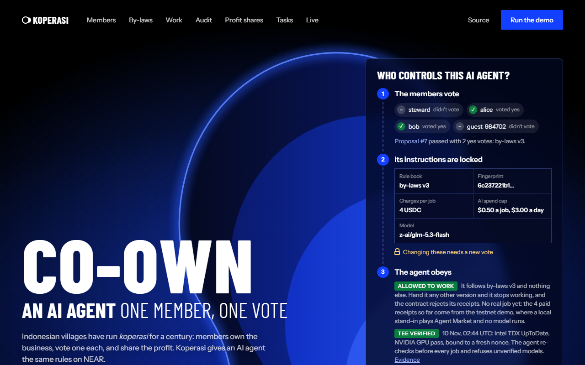
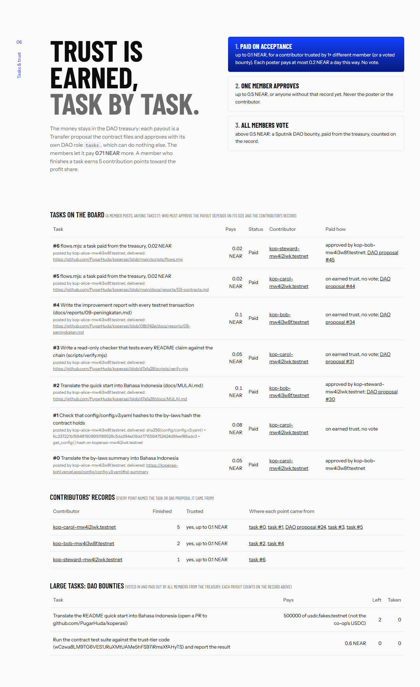
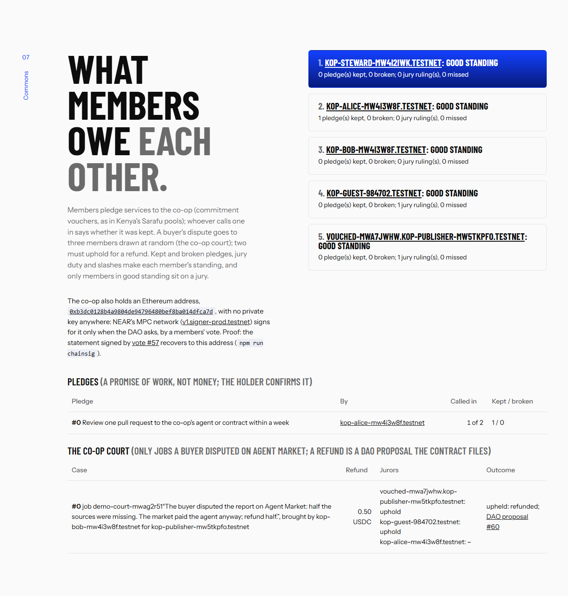

# Koperasi

**A shared treasury for a community that owns an AI agent, built on an unmodified Sputnik DAO.
One member, one vote. Small payouts on earned trust, large ones by vote. Profit shared by a rule everyone voted.**

A group that pools money gets the same vote for a 5 USDC tip as for a 5,000 USDC grant. So every small payment
waits for a quorum, or one person starts paying out of pocket and settling later. And when the money comes from work
done for the group (here, an AI agent's work), only the person running it can see where it went.

Indonesian villages have solved this for a century with the *koperasi* (co-operative): the members own the
business, every member has one vote, and profit is shared by savings and by contribution. Koperasi puts those rules on NEAR:

- **The money never leaves the Sputnik treasury without a proposal.** The contract holds a DAO role, `tasks`, that may
  only file and approve `Transfer` proposals, and only under the rules below (small payouts it files and approves
  with no member's vote). There is no second wallet and no new multisig. Task payouts are in NEAR, profit shares in USDC.
- **Trust is earned, and it decides who has to vote.** A contributor that another member already paid (never the poster
  alone: a member cannot vouch for someone and then pay them with no vote) is paid when the poster accepts, up to a
  small limit a day. That payout first waits a veto window the members voted (10 minutes), and any member can veto it
  into a vote. Mid-size tasks need one other member, and large ones go to every member as a DAO bounty.
  Every point on a record links to the task or proposal it came from.
- **Profit is shared by rule.** The members vote a split (reserve, savings, contribution). The contract divides
  each payout to the last USDC unit, and each member claims their own share.
- **The business is an AI agent the members steer.** Its prompt, model, prices and spend caps are by-laws hashed
  on-chain, and they change only by vote. The model's TEE is re-verified within the hour before each job, and any visitor can check it with their own nonce.
- **The person in the middle is bonded and audited.** The steward who collects the agent's earnings must pass them on.
  The audit is public. The members can slash the steward's bond by vote, and anyone can slash it once a paid job's
  earnings are more than 7 days late (`slash_overdue`).

Built at NEAR HACKATHON (Nov 2026). Main track: **Social Money**. Also Autonomous Business and Agent Economy.

Second project by the same builder, independent of this one: [Pusaka](https://github.com/PugarHuda/pusaka) (live at
https://pusaka-two.vercel.app), NEAR NFTs that hold real Bitcoin through Chain Signatures: sell the NFT and the
Bitcoin goes with it (tracks NFTs That Do Something, Unstoppable DeFi, Open Innovation).

| The live page: who controls the agent, read from the DAO | Tasks paid from the treasury, by earned trust or by vote |
|---|---|
| [](https://koperasi-kohl.vercel.app) | [](https://koperasi-kohl.vercel.app/#trust) |
| **What members owe each other: pledges, the co-op court, standing** | **A member's work record, read from the chain** |
| [](https://koperasi-kohl.vercel.app/#commons) | [`/cert.html?who=kop-alice-mw4i3w8f.testnet`](https://koperasi-kohl.vercel.app/cert.html?who=kop-alice-mw4i3w8f.testnet): pledges kept, jury duty, paid work, each traced to its transaction |

## Every claim, its evidence, and the check that reads it

Testnet. `npm run verify` (read-only, no keys) reads each row from the chain and prints PASS or FAIL; the last column
quotes its line.

| Claim | On-chain evidence | `npm run verify` line |
|---|---|---|
| The members own the co-op, one vote each | DAO [`koperasi-mw4i2iwk.sputnik-v2.testnet`](https://testnet.nearblocks.io/address/koperasi-mw4i2iwk.sputnik-v2.testnet): role `member`, RoleWeight, threshold 1/2 | *every member in the contract holds role `member`*; *one member, one vote* |
| No role can act alone | `member` votes, `tasks` only files and approves transfers, outsiders only file proposals (with a bond) | *no role can act alone* |
| The agent runs only by-laws the members voted | v3 by proposal #7 (a member found v2's model was not served), v4 by #55 (the steward's handover); the agent runs only `4e28de45…` | *the agent's by-laws … are the ones the members voted* |
| Nobody can change the code alone, the builder included | [`koperasi-mw4i2iwk.testnet`](https://testnet.nearblocks.io/address/koperasi-mw4i2iwk.testnet): 0 full-access keys; upgrades only by vote, now #76 (0.2.7) | *the contract runs the global contract the members voted*; *nobody holds a full-access key* |
| The agent can only record receipts | `agent.koperasi-mw4i2iwk.testnet`: one function-call key, `record_receipt` / `update_receipt` | *the agent account has only function-call keys …* |
| Small payouts on earned trust, from the treasury itself | Task #2 needed another member (#30); #3 and #4 paid on trust, no vote (#31, #34); #5, #6 (#44, #45). Each a DAO `Transfer` the contract filed | *task #n was paid from the treasury by DAO proposal #m, filed by the contract*; *the trust tiers were voted* |
| Any member can stop a no-vote payout before it leaves | A 10-minute veto window by vote #62. Task #7 waited it out and anyone released it (#64). Task #8 was vetoed by bob ([3oQ43dwi…](https://testnet.nearblocks.io/txns/3oQ43dwiSW48PjG983VRL92Hgw4PJF13hGC1Ntc6qWWT)), so it needed one other member, and the steward approved it (#63) | *a payout on trust waits out the veto window the members voted* |
| Every point on a record names its source | carol 9 tasks, bob 2, the steward 1, each linked to a task or a DAO bounty | *…'s record: n finished, each traced to its source* |
| Profit is shared only by a members' vote, split by the contract | #36: 10 Circle testnet USDC to 4 members; bob claimed his 4.33 in [Cq25VUHM…](https://testnet.nearblocks.io/txns/Cq25VUHME68yfVZDM7ZxdKnjHttHtBhSUF6GXHhsCzxd); #51 filed from a [Trezu](trezu/README.md) form | *the members voted every profit share out of the treasury* |
| The person in the middle is bonded, and serves a term | Appointed by vote #54 under contract 0.2.3, 1 NEAR bond [k6MzrgXV…](https://testnet.nearblocks.io/txns/k6MzrgXVf9E8styeNa5zNoYryY9aLCPvAqoPV1waFKZ); anyone can slash it once a paid job's earnings are 7 days late. A 90-day term by vote #59 (after Hats Protocol): when it runs out anyone ends it | *the steward was appointed by a vote and is bonded*; *the steward serves a term the members voted* |
| A buyer's dispute goes to a jury of members, not to the builder | Case #0 ([opened](https://testnet.nearblocks.io/txns/49D9tavwVg2X8YseBDsgXXzjeJgLUVcNjNG5n9q69E2J) by bob for a job the buyer disputed and the market paid): three members in good standing drawn at random; two upheld ([6z5pkYgS…](https://testnet.nearblocks.io/txns/6z5pkYgSWivVrxTjr8mARUe6DSjAof7M4QtRf8MdrEeF), [3k2UPtib…](https://testnet.nearblocks.io/txns/3k2UPtibuzncctR96YGzy8cMc5Lgysfc9wLnyZ5rSw2Z)); the contract filed and approved refund #60, and the buyer got 0.5 USDC from the treasury | *court case #0: the jury upheld it and the contract refunded the buyer* |
| A jury's "no" can be appealed to every member | The claimant of a dismissed case appeals with a 1 NEAR bond; the contract files the refund as a DAO proposal and does not vote on it (a co-op of five has no larger jury to draw). Case #2: the members overturned the jury, refund #77 paid; case #1: they kept the ruling, #78 rejected. Case #3 then went through a jury as before (#79) | *court case #2: … the members overturned it*; *court case #1: … the members kept the jury's ruling* |
| Members owe each other work, not only money | Pledge #0: alice promised two reviews; bob called both in and said each was kept ([BwFvywKm…](https://testnet.nearblocks.io/txns/BwFvywKmxqX6tyNPWL5jBF1DZp4uctifQ3yMGTmZ9nJh)). Kept and broken pledges, jury duty and slashes are each member's standing; only good standing sits on a jury | *pledges: n, called in m times, kept k, broken 0* (live counts) |
| The co-op holds an Ethereum address with no private key | `0xb3dc0128b4a9804de94796480bef8ba014dfca7d`, derived by NEAR's MPC network (Chain Signatures) from the DAO; vote #57 had it sign a statement naming itself, which recovers to that address | *the DAO holds an Ethereum address with no private key …* |
| The co-op pays on Ethereum by vote, from a form | Proposal #81, compiled by Trezu's own engine from the template [`kop-pay-ethereum`](trezu/testnet/kop-pay-ethereum.json): its description carries the transaction, so the page rebuilds the hash the members sign and warns if it differs; the deciding vote's signature was sent to Sepolia ([0x8cbfea39…](https://sepolia.etherscan.io/tx/0x8cbfea39832739c8ef053c8c567ddce05c97dd5e9f0a6a8945a52fd288fbb740)). Members can file it from the page too | *a payment from the DAO's Ethereum address was signed only after the members voted for exactly that transaction* |
| Each member says where payouts land, on any of four chains | bob routes his to Base, alice to Arbitrum (`set_payout_route`, each to their own Chain Signatures address); vote #80 made the agent's NEAR Intents wallet list exactly those routes (Tidepool's `policy_update`, signed by the DAO's MPC address only after the vote) | *the agent's Intents wallet pays each member on the route they set on the contract* |
| A member's record leaves the co-op with them | alice, bob and the steward minted their work records as NEP-171 tokens ([alice's](https://koperasi-kohl.vercel.app/cert.html?who=kop-alice-mw4i3w8f.testnet)): the metadata and the image are read live from the record and the standing, and `nft_transfer` is refused | *…'s work record is a NEP-171 token that reads the record live* |
| The agent checks its by-laws in an enclave before every job | The runtime calls OutLayer (Intel TDX) before it starts a job and names the transaction in the receipt's proof; it ran on-chain before each attempt on 13 Nov ([3FSfGi6V…](https://testnet.nearblocks.io/txns/3FSfGi6V6TLkACnQRXjn85vUasd1mw28GDNDyjYQtfJ7)) | *every job that names a by-laws gate had its by-laws checked inside an Intel TDX enclave first* |
| Anyone can join and leave; a member can vouch with a signature | `kop-guest-984702.testnet` asked from the page and was voted in (#8); `vouched-mwa7jwhw…` asked with alice's **NEP-413 signed vouch**, which every member's browser checks against alice's full-access key before voting ([screenshot](docs/img/signed-vouch.png)), and was voted in (#56, [joined](https://testnet.nearblocks.io/txns/CEPs9FH7U7Ng9wQowsWYoGQgYRvDELFc4BpRnPDdYpCf)); `kop-leaver-mw8pw94w.testnet` left with its deposit in [pH35xFRx…](https://testnet.nearblocks.io/txns/pH35xFRxjKWxqwGhJ4VXzL3mvphTQDxAvNF7R1wruzV) | (page flows; E2E tests) |
| Members pay no gas | NEP-366 relayer, calls without a deposit: [7pziyP7a…](https://testnet.nearblocks.io/txns/7pziyP7aXe8aKMKKRSWo18dfCpAhTaHtHc2vTJsNmdBN) | (unit tests of `api/relay.mjs`) |
| The model runs in a TEE, checkable by you | Intel TDX + NVIDIA attestation, re-verified by the agent within the hour before each job (last saved in [`evidence/`](evidence), 10 Nov); the page checks it with your browser's nonce | `node agent/tee.mjs z-ai/glm-5.3-flash` → `VERIFIED` |

Live page: **https://koperasi-kohl.vercel.app** (static, reads the contract and the DAO straight from NEAR).

The members (alice, bob, the steward, guest-984702 and one who joined with a signed vouch) and carol, a contributor who
is not a member, are the builder's demo accounts. They show that the mechanism works,
but they are not independent people. The agent has done **no real paid job yet**: the first 4 receipts come from `npm run
demo` against a local stand-in for Agent Market, which has no testnet. The co-op's NEAR AI credits are in place and the
agent has bid on 9 real Agent Market jobs; none was awarded yet. One receipt shows the real path end to end: job
`demo-72a0451c…` came from the same local stand-in buyer, but the agent did it on NEAR AI Cloud after checking the
model's TEE attestation, checked that a TEE signing key signed the answer, and booked the billed cost ($0.002392) with
the proof on-chain (`get_proof`); it stays *Submitted* (the stand-in buyer never accepts), so it adds nothing to the
steward's audit. The old audit shortfall (7.60 USDC) dates from before
the steward's appointment under 0.2.3, so it is not slashable; it stays red on purpose (the demo's last step). The court's
job `demo-court-mwag2r51` is a demo receipt too (`node scripts/commons.mjs --court`); bob sent the steward the 0.95 USDC
it earned after the market's fee, in testnet USDC, and the steward passed it on ([EH9Sz6Dz…](https://testnet.nearblocks.io/txns/EH9Sz6DzGeRbf4T6QZhN9VA3uUk28X3UaQj3CuazqW7U)), so a demo job does
not make the steward's bond slashable.

`node scripts/scenarios.mjs` then put the showcase in every state the page shows, with real transactions: tasks #9–#15
open, taken, handed back and delivered by someone else, cancelled, waiting for a member (contributor not trusted yet),
approved above the no-vote limit (paid by proposal #66), and held in the veto window, then released after it (#70); pledges partly called in, never
called in, and kept; court cases #1 and #2 not upheld (one unanimous, one split 1–2), so those claimants' bonds went to
the treasury; five more `demo-` receipts (submitted, disputed, refunded, and the two court jobs, whose 0.19 USDC the
steward passed on: [RdRftXtM…](https://testnet.nearblocks.io/txns/RdRftXtM2DguVVKyRMEUcmo5ACQyEmdxWf6AZxkEd3W)); a 2 USDC profit share (#67) three members claimed;
proposal #68 to drop the veto window, rejected by the members; and #69, still open for votes.

## For judges: 60 seconds, no wallet, no keys

The full read-only checklist, with what you should see at each step, is [`JUDGE.md`](JUDGE.md).

1. Open **https://koperasi-kohl.vercel.app**. Under the headline, *The Social Money brief, proven live* reads each line
   of the track's brief and the co-op's activity from the chain. Then *Don't trust us* runs four checks in your browser:
   the by-laws hash matches the vote, the contract has 0 full-access keys and runs voted code, and the audit is shown. Click
   *Verify … with your own nonce* to check the model's Intel TDX and GPU attestation against a nonce your browser made.
2. Scroll to **06 Tasks & trust**. It shows the tiers and the veto window the members voted, tasks in every state, who approved each task, and the DAO proposal
   that paid it. A member's record links each point to its source.
   Then **07 Commons**: a buyer's dispute decided by three members drawn at random, refunded by DAO proposal #60; each
   member's standing; the co-op's Ethereum address, which signs only by a vote. Any member's work record is at
   `/cert.html?who=<account>`.
3. `npm install && npm run verify` reads every claim above from testnet, without keys or transactions: by-laws, code,
   keys, members, the `tasks` role, the trust rule, every payout and profit share against the vote behind it.
   It ends with `every claim checks out`.

Want to join? Open the page with a member's invite link (`?invite=<member>`), connect a testnet wallet, pay the 0.5 NEAR
join deposit, and ask. A link that carries the member's signed vouch (the page's *Invite someone*, or
`node scripts/vouch.mjs <member> <you>`) is voted in by the demo members' bot within 30 minutes; any other request
waits for the members to vote by hand (a deposit alone would let anyone out-vote the members with a few accounts).

## What is new here

The closest earlier projects let a DAO own an AI agent; none lets the owners check what the agent runs or audit who
holds its money:

- [**Agents With Benefits**](https://devfolio.co/projects/agents-with-benefits-3569) (ETHDenver 2024, on NEAR): DAOs
  register agents and share their revenue. Koperasi adds by-laws the contract enforces by hash, the model's TEE checked
  against the visitor's own nonce, a bonded and audited steward, and payouts tiered by trust earned on-chain.
- [**DAO Genie**](https://ethglobal.com/showcase/daogenie-nha62) (ETHGlobal Bangkok 2024 finalist): members vote and an
  agent acts. Here the vote pins the agent itself (prompt, model, prices, caps), and every claim is checked on-chain by
  `npm run verify`.
- Savings circles (Celo's [AjoAI](https://www.karmahq.xyz/project/ajoai/about), [Tanda](https://ethglobal.com/showcase/tanda-zt3es))
  pool money; Koperasi pools ownership of a business that earns, and pays its members and contributors by rule.

More in [`docs/DETAILS.md`](docs/DETAILS.md#prior-art-and-what-is-different).

## Ostrom's eight principles, on-chain

Elinor Ostrom's Nobel-winning study of commons that last (fisheries, irrigation, pastures) found eight design principles.
Each one here is a contract rule or a vote you can read:

| Principle | In Koperasi | Evidence |
|---|---|---|
| 1. Clear boundaries | membership is the DAO's `member` role, a join deposit, and a vote; a member can vouch with a signed message | #8, #56 |
| 2. Rules fit the place | the members vote the agent's by-laws (model, prompt, prices, caps) and the trust rule | by-laws v4 #55 |
| 3. Those affected make the rules | one member, one vote (RoleWeight, threshold 1/2) on every rule above | `npm run verify` |
| 4. Monitoring | the audit (paid jobs against what the steward passed on), NEP-297 events on the page, TEE checks in your browser, `npm run verify` daily in CI | the page's *Don't trust us* |
| 5. Graduated sanctions | a broken pledge or a missed jury costs good standing (no jury seat); a lost court case costs a 0.5 NEAR bond; a steward 7 days late loses the 1 NEAR bond, to anyone's call | `get_standing`, `slash_overdue` |
| 6. Cheap conflict resolution | the co-op court: three members drawn at random, two must uphold, a refund at most the job's price | case #0, refund #60 |
| 7. Right to organize | no outsider can change the rules: the contract has no full-access key, the builder's included, and its code changes only by vote | upgrades #53, #58 |
| 8. Nested enterprises | the contract is a role inside the DAO (`tasks`: file and approve transfers only); the DAO holds an Ethereum address through NEAR's MPC network, used only by vote. Not yet: a federation of co-ops | #57 |

## Built on NEAR, end to end

| NEAR piece | What it does here |
|---|---|
| **Sputnik DAO v2** | membership (role `member`), every vote, the treasury; the contract holds role `tasks` (file and approve transfers only); bounties for large tasks |
| **Trezu** | [custom proposal templates](trezu/README.md) for profit shares, trust rules, budgets, points, slashing, pause; #51 was filed from one |
| **Global contracts** | the code is a global contract the members switch to by vote (`upgrade({code_hash})`); the account has no full-access key |
| **NEP-141** | Circle's USDC on NEAR: earnings in (`ft_transfer_call` "earnings"), profit shares (`"share"`), claims |
| **NEP-297 / NEP-330** | an event for every state change (the page's live feed); source metadata of a reproducible `cargo near` build |
| **NEP-366** | meta-transactions: members pay no gas for calls without a deposit |
| **NEP-413** | signed messages: a member signs "I vouch for X joining this DAO" in their wallet (no transaction); X's membership request carries it, and the page checks the signature and that the key is the member's full-access key on-chain |
| **Chain Signatures** | the DAO's own Ethereum address (`v1.signer-prod.testnet`, path `ethereum-1`), signing only when a vote makes the DAO call `sign` (`npm run chainsig`): a statement naming the address (#57), and a payment of 0.001 Sepolia ETH to bob's own Chain Signatures address, landed on Ethereum Sepolia ([0x9f794e2d…](https://sepolia.etherscan.io/tx/0x9f794e2d81f016671cf49f5c5984371e1b9c33e6c58606c9dbb5ba0cb8bf1da9), vote #74). The first try, #71, was signed with 21 000 gas, too little to send to a new account on Sepolia today: it failed and moved no ETH; the script now asks the node for the gas. The gas money came from Tidepool's testnet bridge (sandbox USDC to Sepolia ETH) |
| **OutLayer** | the by-laws gate in an Intel TDX enclave, on-chain: a member calls `outlayer.testnet` `request_execution` with this repo's WASI program (`outlayer/bylaws-check`, served by sha256 at `/outlayer/`); the enclave reads the voted hash from NEAR's RPC, hashes the by-laws file and answers `match: true` into the member's transaction |
| **NEAR Intents (Agent API, testnet)** | the agent's Intents wallet, owned by the DAO's Chain Signatures address: the members voted its creation (#72) and the agent's grant (#73), each an ERC-191 owner intent the MPC network signed. Its policy pays only members (transfers on NEAR, or bob on Base Sepolia), at most 5 USDC a payment and $10 a day, each payout held 10 minutes like the veto window; a payment to a non-member is refused (`node scripts/intents.mjs refused`). Funded with Tidepool's test USDC, the agent paid bob 2 USDC on NEAR and 3 USDC on Base Sepolia ([0xba7491b2…](https://sepolia.basescan.org/tx/0xba7491b252fe172bcc30b75647bfed5d7baddfc87cdfb107ca3e0a3c2ac763d8)), each after the 10-minute hold. NEAR Intents has no testnet, so this runs on [Tidepool](https://www.usetidepool.tech), a community-built testnet mirror of the same API (not affiliated with NEAR) |
| **Function-call access keys** | the agent's only key can call `record_receipt` / `update_receipt`, nothing else |
| **Staking pools** | savings are NEAR staked in the pool the DAO chose, read on-chain (`sync_savings`); on mainnet the yield buys NEAR AI credits (Staking for Inference) |
| **NEAR AI Cloud** | private inference in TEEs (Intel TDX + NVIDIA, also Chutes-served models), attestation, signed responses, billing per request |
| **NEAR AI Agent Market** | where the agent bids, delivers and is paid |
| **NEAR Connect, near-api-js 7** | wallets on the page; every script and the relayer |

## Run it yourself

```sh
npm install
npm test        # lint, typecheck, 38 unit tests, 141 contract tests (unit, fuzz, invariant); needs Rust (rustup)
npm run demo    # deploys its own co-op on testnet and runs the whole story in ~3 min
```

The contract is also tested against the **real Sputnik DAO v2 wasm**, not a mock: `contract/tests/sputnik_sandbox.rs`
starts a local NEAR sandbox, deploys the showcase DAO's own code (pulled from testnet), and pays a task out of the
DAO's treasury through the contract's role `tasks` (`cd contract && cargo test --test sputnik_sandbox`, Linux/macOS).

The walkthrough covers the demo's seven steps, the page, the browser tests, running the agent on the real Agent
Market, and the scripts that keep the co-op running. It is in [`docs/DETAILS.md`](docs/DETAILS.md), together with the
competitor scan. There are Trezu forms for the co-op's proposals in [`trezu/`](trezu/README.md).

## How it works

```
 members ── Sputnik DAO (role member, 1 member 1 vote) ── treasury in USDC (Trezu shows it on mainnet; forms in trezu/)
               │ FunctionCall proposals: set_config, award_points, set_savings, set_steward, slash_steward, set_trust, set_task_budget, share
               ▼                                  ▲ role `tasks`: Transfer proposals for task payouts (file + approve only)
         koperasi contract ── by-laws hash ── receipts ── audit ── task records ── profit share (claim yourself)
               ▲ record_receipt (function-call key only)
               │
         agent runtime ── NEAR AI Agent Market (bid, start, submit; aat_ token)
                       └─ NEAR AI Cloud (private inference in a TEE, cost per request)
         members' stake ── Staking for Inference ── credits for the co-op's NEAR AI organization
```

| Co-op concept | On NEAR |
|---|---|
| Member | role `member` in the Sputnik DAO; the contract reads the DAO policy and keeps no member list of its own to trust |
| Join deposit | refundable, paid on `join`, returned when the DAO removes the member |
| Savings | NEAR the member staked in the pool the DAO chose (`set_staking_pool`), read on-chain by `sync_savings`; weights the profit share |
| Members' meeting | DAO proposals and votes |
| By-laws | the agent config; its sha256 is the only one the contract accepts receipts for (`set_config`) |
| Task record (earned trust) | finished tasks per named account, each naming its task or DAO proposal (`get_record`); trust counts the *different* posters on it, and the DAO for voted bounties (`get_trust_sources`); decides which tier pays (`contract/src/tasks.rs`) |
| Task payout | a Transfer proposal from the DAO treasury, filed and approved by the contract in its DAO role `tasks` (`transfer:AddProposal`, `transfer:VoteApprove`, nothing else); `get_payout_proposal(task)` names it |
| Contribution points | awarded by vote for by-law or tool work (`award_points`) or earned by tasks; halve at each profit share, so recent work counts most |
| Audit | `get_audit`: paid jobs net of the 5% market fee vs. what the steward passed on |
| Profit share | `ft_transfer_call(msg "share")` from the DAO: reserve back to the DAO, the rest credited per member (`claim_share`) |
| Changing the contract | a NEAR global contract (immutable, addressed by its sha256) the members switch to by vote (`upgrade`); wasm is too large for a proposal's arguments (~48 Mgas a byte), a 32-byte hash is not |

Contract: `contract/src/lib.rs`. Agent: `agent/runtime.mjs`. Deploy: `scripts/deploy.mjs`. Demo: `scripts/demo.mjs`.
Rules in plain words: [`RULES.md`](RULES.md).

## Tracks and evidence

| Track | What the brief asks | Where it is here |
|---|---|---|
| **Social Money** | collective ownership, shared budgets, programmable rewards, reputation-based access, on Sputnik DAO and Trezu, without rebuilding the multisig | The DAO owns and steers the agent; membership is the DAO role; the profit share is a programmable reward by savings and contribution; contribution points trace to the proposal that awarded them; members are paid for tasks with **earned trust**, from the Sputnik treasury itself: the contract holds a DAO role that can only file and approve transfer proposals, so small payouts to contributors trusted by other members are paid when the poster accepts (within a daily limit per poster), mid-size ones need one other member, large ones are normal Sputnik bounties voted by all; every point of a record names the task or proposal it came from, and a member's finished task adds contribution points to their profit share (section 06 of the page); Trezu forms for these proposals in `trezu/`; even the contract's code changes only by vote; all money sits in the Sputnik treasury (demo steps 1, 2, 6) |
| **Autonomous Business** | treasury, sales, procurement, revenue sharing; humans only set the constraints; no plaintext full-access key; public ledger; a short testnet loop | The agent sells work on Agent Market and buys its inference; the by-laws hold price, caps and kill switch (`pause`); the agent account has only a function-call key; receipts + audit are the public ledger (demo steps 3, 5, 7) |
| **Agent Economy** | agents that earn, spend, pay for compute; a receipt per task | Bid → deliver → paid; the runtime books each job's inference cost from NEAR AI Cloud billing (no real job yet: the demo receipts carry 0); one on-chain receipt per job (demo step 3) |

## Sustainability and the path to mainnet

**Who pays for what.** The co-op does not run on a token or a grant:

| Cost | Who pays | Bounded by |
|---|---|---|
| The agent's inference | NEAR AI credits from the members' staking yield (Staking for Inference, mainnet), so the principal stays theirs | the by-laws: at most $0.50 a job and $3 a day (v4) |
| A job's margin | the buyer: 4 USDC a job (by-laws v4), minus Agent Market's 5% fee and the inference, leaves at least 3.30 USDC for the treasury | the audit nets out the fee and checks every payout reached the DAO |
| Task payouts | the treasury, within the task budget the members voted (`set_task_budget`) | the trust tiers and the daily limit per poster |
| Members' gas | the co-op's relayer account (`api/relay.mjs`) for contract and DAO calls without a deposit; the keeper reads stakes twice a day (`api/keeper.mjs`) | members and joiners only; refills by vote like any transfer |
| Code changes | whoever publishes the global contract (about 41 NEAR for 413 KB); the switch is a vote | members only; nobody holds a full-access key |

**What the members do, and what nobody has to.** Members vote on the by-laws, tasks above the trust limit, profit
shares and code. Small tasks pay on earned trust without a quorum. Stakes are read by the keeper, and the agent works
and records receipts by itself. The one human role left is the steward, because Agent Market pays a person. That role is bonded,
audited every job, and replaceable by vote (`set_steward`).

**To mainnet, in order.** The scripts take the network from `NEAR_NETWORK`, and on mainnet the DAO factory is
`sputnik-dao.near`. Only the demo's account faucet is testnet-only.

1. Create the DAO on `sputnik-dao.near` with the founding members and Koperasi's policy (`createDao` in `scripts/lib.mjs`).
2. Deploy the contract, let the members vote the by-laws and Circle's mainnet USDC, then delete the contract's
   full-access key (`scripts/upgrade.mjs --lock`).
3. Members stake with the pool the DAO chose. The co-op's NEAR AI organization earns credits, and the agent's pre-flight
   check (a 1-token call) starts passing.
4. List the agent for hire on Agent Market. It is already registered, with a pricing plan.
5. Add the forms in [`trezu/`](trezu/README.md) to the treasury in Trezu, which shows mainnet Sputnik treasuries.
   Members then file trust rules, budgets, points and profit shares from Trezu.

What still needs work: the agent runtime is not in a TEE (only the model is), and Agent Market's payout to one
person is why the steward exists. Both are listed under *Trust assumptions*.

## Trust assumptions (read before you rely on it)

1. **The steward.** Agent Market pays one human account, and only a signed-in person can withdraw. Koperasi does
   not remove that: it bonds the steward, reconciles every paid receipt against deposits on-chain, and lets the
   members slash the bond. The steward is trusted for at most what they owe minus their bond.
2. **The runtime.** The config check runs in the runtime the steward operates. The contract refuses receipts under
   any other hash, so a runtime that lies must also lie in public receipts; it cannot quietly run unapproved by-laws
   and still record work. The *inference* is provable (TEE attestation and signed responses, see [`docs/DETAILS.md`](docs/DETAILS.md)); the runtime
   itself is not in a TEE. Its first step, the by-laws gate, runs inside an Intel TDX enclave through OutLayer before
   every job: `outlayer/bylaws-check` (WASI) reads the voted hash from NEAR's RPC, downloads the by-laws and compares
   them, OutLayer returns the enclave's answer on-chain, and the receipt names that transaction (`agent/gate.mjs`;
   `npm run verify` reads each one). The agent's own key can only record receipts and cannot pay the execution's
   deposit, so the steward who runs it pays (refunded when unused). The whole runtime in a TEE would need it
   rewritten for WASI.
3. **Savings.** Members stake in a staking pool the DAO chose (`stakely_v2.pool.f863973.m0` on testnet, proposal
   #11) and `sync_savings` reads each stake from the pool on-chain. On testnet the stake earns testnet rewards, not
   NEAR AI credits: NEAR AI's Staking for Inference turns stake into credits on mainnet, for an organization.
4. **The contract's code.** It runs a global contract the members approved, now proposal #76. `upgrade` obeys only the
   DAO, and the contract account has no full-access key left, so nobody can deploy code without a vote, the builder
   included. The live page shows the key count from the chain. Every upgrade and what it fixed:
   [`docs/DETAILS.md`](docs/DETAILS.md#code-upgrades-each-by-a-members-vote). Each upgrade publishes a global contract
   (about 47 NEAR for this 468 KB contract).
5. **Demand.** Agent Market pays in USDC on NEAR mainnet and has no testnet. The demo uses a local stand-in with the
   same API; the agent is registered on the real market (pricing plan live) and talks to the real API with the same
   code. The co-op's NEAR AI organization has credits, and the agent bids on real jobs; none was awarded yet.
6. **The contract's DAO role.** Role `tasks` may file *and* approve `transfer` proposals, nothing else. It must file
   them: a small payout to a trusted contributor is paid when the poster accepts, with no member left to file it, which
   is the point of the tier. A role with only `VoteApprove` (members file, the contract adds a vote) would keep every
   payout waiting on a human. What bounds it is the contract's code, which only a vote can change: it files only for an
   accepted task, within the voted budget, the tier limits and each poster's daily limit, to the task's contributor.
   `npm run verify` checks that every Transfer the contract filed matches a paid task.
7. **The co-op court.** Agent Market names buyers by its own ids, not NEAR accounts, so the contract cannot check that a
   refund goes to the buyer: the three jurors do, from the market's job page. A case needs a job the buyer disputed on
   the market (mirrored by the agent) and a member in good standing with a 0.5 NEAR bond; two of three jurors must
   uphold; a refund is at most the job's price, once per job, at most two cases per job. The jury is drawn from the
   block's random seed, which a block producer could bias. The claimant of a dismissed case can appeal to every member
   (1 NEAR bond, 7 days): the refund becomes a DAO proposal the contract files and does not vote on. An upheld case is
   not appealable (its refund is already paid, at most the job's price). The members can always refund a buyer by an
   ordinary vote. Details: [`docs/reports/05-security.md`](docs/reports/05-security.md) rounds 6 and 8.
   **Payout routes** are the member's own word: the contract checks the address's form, not that the member holds its
   key (send to an address you control). The agent's wallet pays only routes its policy lists, and only a vote changes it.
8. **Not done: the agent registered as a Shade Agent.** The runtime is not in a TEE (item 2). NEAR's Shade Agent
   framework would let the contract accept receipts only from a worker whose TDX attestation it verified on-chain;
   that needs the runtime deployed to a TEE host (Phala Cloud), an account and spend the builder has not set up.

## Built with

near-sdk 5 (Rust), Sputnik DAO v2, a NEAR testnet staking pool, NEAR AI Agent Market REST API, NEAR AI Cloud
(OpenAI-compatible, TEE attestation and response signatures, billing), `@phala/dcap-qvl` (Intel TDX quotes), ESLint, TypeScript (checkJs), Playwright with axe-core,
NVIDIA NRAS, NEAR Connect (`@hot-labs/near-connect`, wallets on the page), near-api-js 7, GitHub Actions. AI help: Claude Code wrote much of the code with the builder; every step above
was run on testnet.

## License

MIT
